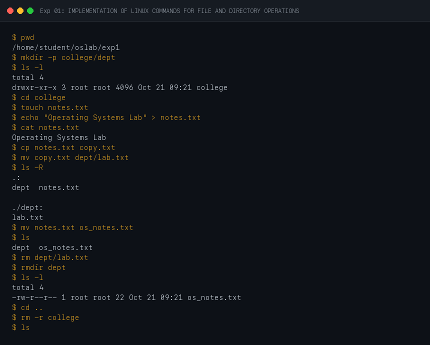

# Experiment 1: IMPLEMENTATION OF LINUX COMMANDS FOR FILE AND DIRECTORY OPERATIONS

**Course Outcome:** CO1  
**Course Code:** CSA04 - Operating Systems  
**Student Name:** Rakul K (192525143)  

## AIM
To execute basic Linux commands for creating, listing, copying, moving, renaming and 
deleting files and directories.

## PROCEDURE
1. Open the Linux terminal. 
2. Use pwd to display the present working directory. 
3. Create directories using mkdir (with -p for nested directories). 
4. Create files using touch and write text into a file using echo with redirection. 
5. List the contents using ls -l and display a file using cat. 
6. Copy a file using cp, move or rename it using mv. 
7. Delete files using rm and directories using rmdir or rm -r. 
8. Observe the output of each command.

## SOURCE CODE (script.sh)
```bash
#!/usr/bin/env bash
# IMPLEMENTATION OF LINUX COMMANDS FOR FILE AND DIRECTORY OPERATIONS
set -euo pipefail

pwd 
mkdir -p college/dept 
ls -l 
cd college 
touch notes.txt 
echo "Operating Systems Lab" > notes.txt 
cat notes.txt 
cp notes.txt copy.txt 
mv copy.txt dept/lab.txt 
ls -R 
mv notes.txt os_notes.txt 
ls 
rm dept/lab.txt 
rmdir dept 
ls -l 
cd .. 
rm -r college 
ls
```

## EXPECTED & VERIFIED OUTPUT
```
$ pwd 
/home/student/oslab/exp1 
$ mkdir -p college/dept 
$ ls -l 
total 4 
drwxr-xr-x 3 root root 4096 Oct 21 09:21 college 
$ cd college 
$ touch notes.txt 
$ echo "Operating Systems Lab" > notes.txt 
$ cat notes.txt 
Operating Systems Lab 
$ cp notes.txt copy.txt 
$ mv copy.txt dept/lab.txt 
$ ls -R 
.: 
dept  notes.txt 
  
./dept: 
lab.txt 
$ mv notes.txt os_notes.txt 
$ ls 
dept  os_notes.txt 
$ rm dept/lab.txt 
$ rmdir dept 
$ ls -l 
total 4 
-rw-r--r-- 1 root root 22 Oct 21 09:21 os_notes.txt 
$ cd .. 
$ rm -r college 
$ ls
```

## TERMINAL OUTPUT SCREENSHOT



## RESULT
Thus the Linux commands for file and directory operations were executed successfully and the 
output was verified.
