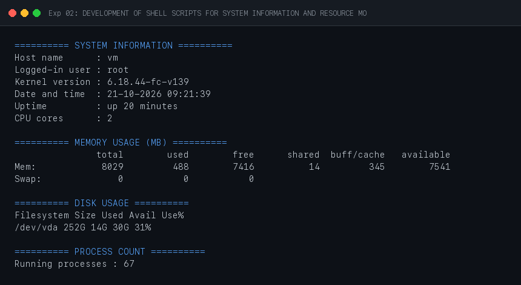

# Experiment 2: DEVELOPMENT OF SHELL SCRIPTS FOR SYSTEM INFORMATION AND RESOURCE MONITORING

**Course Outcome:** CO1  
**Course Code:** CSA04 - Operating Systems  
**Student Name:** Rakul K (192525143)  

## AIM
To develop a shell script that displays system information and monitors resource usage such as 
CPU, memory and disk.

## PROCEDURE
1. Start the script with the interpreter line #!/bin/bash. 
2. Display the host name, logged -in user and kernel version using hostname, whoami and 
uname -r. 
3. Display the system uptime using uptime -p. 
4. Display the number of CPU cores using nproc. 
5. Display memory usage using free -m. 
6. Display disk usage of the root file system using df -h /. 
7. Display the number of running processes using ps. 
8. Save the script, give execute permission and run it.

## SOURCE CODE (script.sh)
```bash
#!/bin/bash 
# System information and resource monitoring report 
echo "========== SYSTEM INFORMATION ==========" 
echo "Host name      : $(hostname)" 
echo "Logged-in user : $(whoami)" 
echo "Kernel version : $(uname -r)" 
echo "Date and time  : $(date '+%d-%m-%Y %H:%M:%S')" 
echo "Uptime         : $(uptime -p)" 
echo "CPU cores      : $(nproc)" 
echo 
echo "========== MEMORY USAGE (MB) ==========" 
free -m 
echo 
echo "========== DISK USAGE ==========" 
df -h / | awk '{print $1, $2, $3, $4, $5}' 
echo 
echo "========== PROCESS COUNT ==========" 
echo "Running processes : $(ps -e --no-headers | wc -l)"
```

## EXPECTED & VERIFIED OUTPUT
```
========== SYSTEM INFORMATION ========== 
Host name      : vm 
Logged-in user : root 
Kernel version : 6.18.44-fc-v139 
Date and time  : 21-10-2026 09:21:39 
Uptime         : up 20 minutes 
CPU cores      : 2 
  
========== MEMORY USAGE (MB) ========== 
               total        used        free      shared  buff/cache   available 
Mem:            8029         488        7416          14         345        7541 
Swap:              0           0           0 
  
========== DISK USAGE ========== 
Filesystem Size Used Avail Use% 
/dev/vda 252G 14G 30G 31% 
  
========== PROCESS COUNT ========== 
Running processes : 67
```

## TERMINAL OUTPUT SCREENSHOT



## RESULT
Thus the shell script to display system information and monitor resource usage was executed 
successfully.
