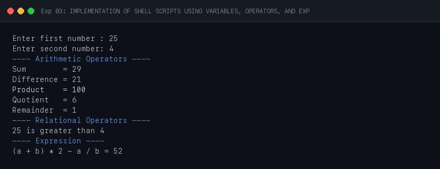

# Experiment 3: IMPLEMENTATION OF SHELL SCRIPTS USING VARIABLES, OPERATORS, AND EXPRESSIONS

**Course Outcome:** CO1  
**Course Code:** CSA04 - Operating Systems  
**Student Name:** Rakul K (192525143)  

## AIM
To write a shell script that uses variables, arithmetic operators, relational operators and 
expressions.

## PROCEDURE
1. Read two numbers from the user using read. 
2. Store them in variables a and b. 
3. Perform addition, subtraction, multiplication, division and modulus using $(( )). 
4. Compare the numbers using relational operators -gt, -lt and -eq. 
5. Evaluate a compound expression and display the result. 
6. Display all results.

## SOURCE CODE (script.sh)
```bash
#!/bin/bash 
echo -n "Enter first number : " 
read a 
echo -n "Enter second number: " 
read b 
echo "---- Arithmetic Operators ----" 
echo "Sum        = $((a + b))" 
echo "Difference = $((a - b))" 
echo "Product    = $((a * b))" 
echo "Quotient   = $((a / b))" 
echo "Remainder  = $((a % b))" 
echo "---- Relational Operators ----" 
[ $a -gt $b ] && echo "$a is greater than $b" 
[ $a -lt $b ] && echo "$a is less than $b" 
[ $a -eq $b ] && echo "$a is equal to $b" 
echo "---- Expression ----" 
result=$(( (a + b) * 2 - a / b )) 
echo "(a + b) * 2 - a / b = $result"
```

## INPUT DATA
```
25 
4
```

## EXPECTED & VERIFIED OUTPUT
```
Enter first number : 25 
Enter second number: 4 
---- Arithmetic Operators ---- 
Sum        = 29 
Difference = 21 
Product    = 100 
Quotient   = 6 
Remainder  = 1 
---- Relational Operators ---- 
25 is greater than 4 
---- Expression ---- 
(a + b) * 2 - a / b = 52
```

## TERMINAL OUTPUT SCREENSHOT



## RESULT
Thus the shell script using variables, operators and expressions was executed successfully.
