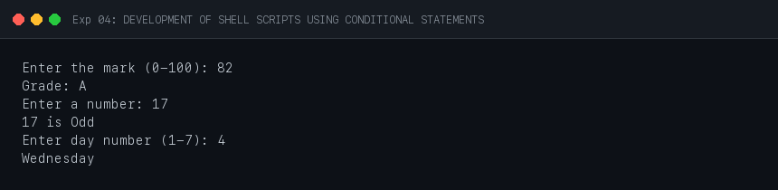

# Experiment 4: DEVELOPMENT OF SHELL SCRIPTS USING CONDITIONAL STATEMENTS

**Course Outcome:** CO1  
**Course Code:** CSA04 - Operating Systems  
**Student Name:** Rakul K (192525143)  

## AIM
To write a shell script using conditional statements (if-else, elif and case).

## PROCEDURE
1. Read a mark from the user. 
2. Use if-elif-else to find the grade of the student. 
3. Read a number and use if-else to check whether it is even or odd. 
4. Read a day number and use the case statement to display the day name. 
5. Display the results.

## SOURCE CODE (script.sh)
```bash
#!/bin/bash 
echo -n "Enter the mark (0-100): " 
read mark 
if [ $mark -ge 90 ]; then 
    echo "Grade: S" 
elif [ $mark -ge 75 ]; then 
    echo "Grade: A" 
elif [ $mark -ge 50 ]; then 
    echo "Grade: B" 
else 
    echo "Grade: Fail" 
fi 
  
echo -n "Enter a number: " 
read n 
if [ $((n % 2)) -eq 0 ]; then 
    echo "$n is Even" 
else 
    echo "$n is Odd" 
fi 
  
echo -n "Enter day number (1-7): " 
read d 
case $d in 
    1) echo "Sunday" ;; 
    2) echo "Monday" ;; 
    3) echo "Tuesday" ;; 
    4) echo "Wednesday" ;; 
    5) echo "Thursday" ;; 
    6) echo "Friday" ;; 
    7) echo "Saturday" ;; 
    *) echo "Invalid day number" ;; 
esac
```

## INPUT DATA
```
82 
17 
4
```

## EXPECTED & VERIFIED OUTPUT
```
Enter the mark (0-100): 82 
Grade: A 
Enter a number: 17 
17 is Odd 
Enter day number (1-7): 4 
Wednesday
```

## TERMINAL OUTPUT SCREENSHOT



## RESULT
Thus the shell script using conditional statements was executed successfully.
