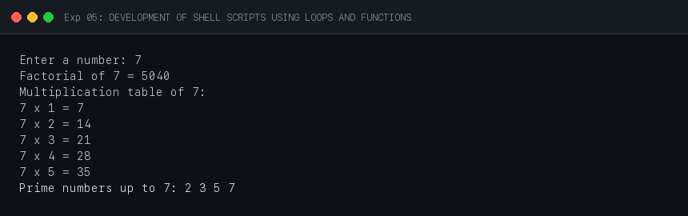

# Experiment 5: DEVELOPMENT OF SHELL SCRIPTS USING LOOPS AND FUNCTIONS

**Course Outcome:** CO1  
**Course Code:** CSA04 - Operating Systems  
**Student Name:** Rakul K (192525143)  

## AIM
To write a shell script using loops (for, while) and user-defined functions.

## PROCEDURE
1. Define a function factorial() that computes the factorial using a while loop. 
2. Define a function is_prime() that checks whether a number is prime using a for loop. 
3. Read a number from the user. 
4. Call factorial() and display the result. 
5. Use a for loop to display the multiplication table of the number. 
6. Use a for loop to call is_prime() and print the prime numbers up to the given number.

## SOURCE CODE (script.sh)
```bash
#!/bin/bash 
factorial() { 
    local n=$1 f=1 
    while [ $n -gt 1 ]; do 
        f=$((f * n)) 
        n=$((n - 1)) 
    done 
    echo $f 
} 
  
is_prime() { 
    local n=$1 
    [ $n -lt 2 ] && return 1 
    for ((i = 2; i * i <= n; i++)); do 
        [ $((n % i)) -eq 0 ] && return 1 
    done 
    return 0 
} 
  
echo -n "Enter a number: " 
read num 
echo "Factorial of $num = $(factorial $num)" 
echo "Multiplication table of $num:" 
for i in 1 2 3 4 5; do 
    echo "$num x $i = $((num * i))" 
done 
echo -n "Prime numbers up to $num: " 
for ((k = 2; k <= num; k++)); do 
    is_prime $k && echo -n "$k " 
done 
echo
```

## INPUT DATA
```
7
```

## EXPECTED & VERIFIED OUTPUT
```
Enter a number: 7 
Factorial of 7 = 5040 
Multiplication table of 7: 
7 x 1 = 7 
7 x 2 = 14 
7 x 3 = 21 
7 x 4 = 28 
7 x 5 = 35 
Prime numbers up to 7: 2 3 5 7
```

## TERMINAL OUTPUT SCREENSHOT



## RESULT
Thus the shell script using loops and functions was executed successfully.
