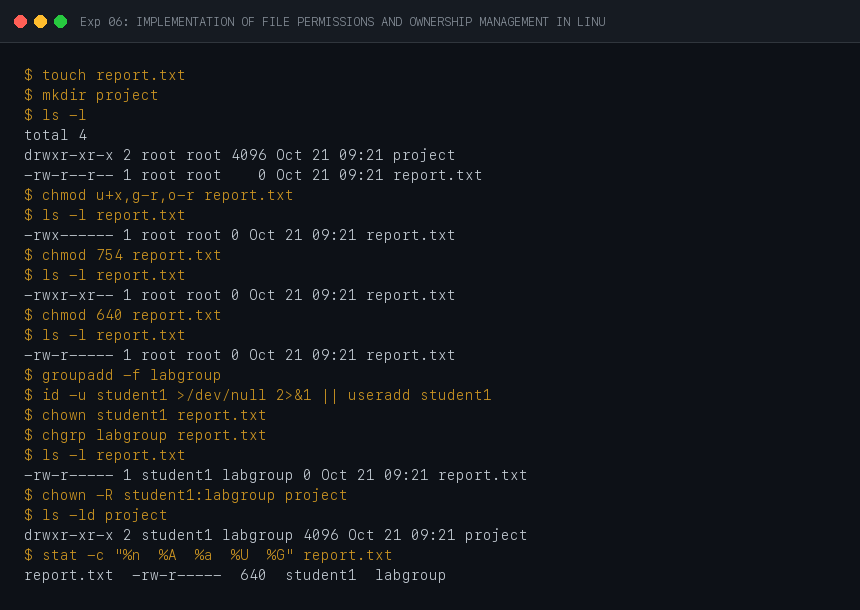

# Experiment 6: IMPLEMENTATION OF FILE PERMISSIONS AND OWNERSHIP MANAGEMENT IN LINUX

**Course Outcome:** CO1  
**Course Code:** CSA04 - Operating Systems  
**Student Name:** Rakul K (192525143)  

## AIM
To manage file permissions and ownership in Linux using chmod, chown and chgrp.

## PROCEDURE
1. Create a file and a directory. 
2. View the current permissions using ls -l. 
3. Change permissions using symbolic mode (u, g, o with +, -). 
4. Change permissions using octal mode (for example 754 and 640). 
5. Create a user and a group, then change the owner using chown and the group using chgrp. 
6. Verify the changes with ls -l and stat.

## SOURCE CODE (script.sh)
```bash
#!/usr/bin/env bash
# IMPLEMENTATION OF FILE PERMISSIONS AND OWNERSHIP MANAGEMENT IN LINUX
set -euo pipefail

touch report.txt 
mkdir project 
ls -l 
chmod u+x,g-r,o-r report.txt 
ls -l report.txt 
chmod 754 report.txt 
ls -l report.txt 
chmod 640 report.txt 
ls -l report.txt 
groupadd -f labgroup 
id -u student1 >/dev/null 2>&1 || useradd student1 
chown student1 report.txt 
chgrp labgroup report.txt 
ls -l report.txt 
chown -R student1:labgroup project 
ls -ld project 
stat -c "%n  %A  %a  %U  %G" report.txt
```

## EXPECTED & VERIFIED OUTPUT
```
$ touch report.txt 
$ mkdir project 
$ ls -l 
total 4 
drwxr-xr-x 2 root root 4096 Oct 21 09:21 project 
-rw-r--r-- 1 root root    0 Oct 21 09:21 report.txt 
$ chmod u+x,g-r,o-r report.txt 
$ ls -l report.txt 
-rwx------ 1 root root 0 Oct 21 09:21 report.txt 
$ chmod 754 report.txt 
$ ls -l report.txt 
-rwxr-xr-- 1 root root 0 Oct 21 09:21 report.txt 
$ chmod 640 report.txt 
$ ls -l report.txt 
-rw-r----- 1 root root 0 Oct 21 09:21 report.txt 
$ groupadd -f labgroup 
$ id -u student1 >/dev/null 2>&1 || useradd student1 
$ chown student1 report.txt 
$ chgrp labgroup report.txt 
$ ls -l report.txt 
-rw-r----- 1 student1 labgroup 0 Oct 21 09:21 report.txt 
$ chown -R student1:labgroup project 
$ ls -ld project 
drwxr-xr-x 2 student1 labgroup 4096 Oct 21 09:21 project 
$ stat -c "%n  %A  %a  %U  %G" report.txt 
report.txt  -rw-r-----  640  student1  labgroup
```

## TERMINAL OUTPUT SCREENSHOT



## RESULT
Thus the file permissions and ownership were modified using chmod, chown and chgrp and 
verified successfully.
