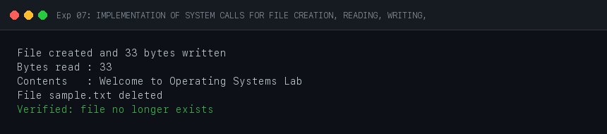

# Experiment 7: IMPLEMENTATION OF SYSTEM CALLS FOR FILE CREATION, READING, WRITING, AND DELETION

**Course Outcome:** CO1  
**Course Code:** CSA04 - Operating Systems  
**Student Name:** Rakul K (192525143)  

## AIM
To write a C program that creates, writes, reads and deletes a file using the system calls open(), 
write(), read(), close() and unlink().

## PROCEDURE
1. Include <fcntl.h> and <unistd.h>. 
2. Create a file using open() with O_CREAT | O_WRONLY | O_TRUNC and permission 
0644. 
3. Write a string into the file using write() and close it. 
4. Open the file again in read-only mode and read the contents into a buffer using read(). 
5. Display the contents and close the file. 
6. Delete the file using unlink() and confirm that it no longer exists using access().

## SOURCE CODE (main.c)
```c
#include <stdio.h> 
#include <string.h> 
#include <fcntl.h> 
#include <unistd.h> 
  
int main() 
{ 
    char *fname = "sample.txt"; 
    char data[] = "Welcome to Operating Systems Lab\n"; 
    char buf[100]; 
    int fd, n; 
  
    fd = open(fname, O_CREAT | O_WRONLY | O_TRUNC, 0644); 
    if (fd < 0) { perror("open"); return 1; } 
    n = write(fd, data, strlen(data)); 
    printf("File created and %d bytes written\n", n); 
    close(fd); 
  
    fd = open(fname, O_RDONLY); 
    n = read(fd, buf, sizeof(buf) - 1); 
    buf[n] = '\0'; 
    printf("Bytes read : %d\n", n); 
    printf("Contents   : %s", buf); 
    close(fd); 
  
    if (unlink(fname) == 0) 
        printf("File %s deleted\n", fname); 
    if (access(fname, F_OK) != 0) 
        printf("Verified: file no longer exists\n"); 
    return 0; 
}
```

## EXPECTED & VERIFIED OUTPUT
```
File created and 33 bytes written 
Bytes read : 33 
Contents   : Welcome to Operating Systems Lab 
File sample.txt deleted 
Verified: file no longer exists
```

## TERMINAL OUTPUT SCREENSHOT



## RESULT
Thus the C program to create, write, read and delete a file using system calls was executed 
successfully.
