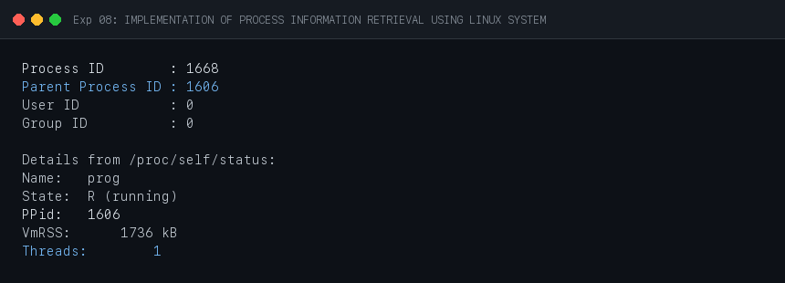

# Experiment 8: IMPLEMENTATION OF PROCESS INFORMATION RETRIEVAL USING LINUX SYSTEM INTERFACES

**Course Outcome:** CO1  
**Course Code:** CSA04 - Operating Systems  
**Student Name:** Rakul K (192525143)  

## AIM
To write a C program that retrieves process information using system calls and the /proc 
interface.

## PROCEDURE
1. Get the process ID and parent process ID using getpid() and getppid(). 
2. Get the user ID and group ID using getuid() and getgid(). 
3. Open the file /proc/self/status using fopen(). 
4. Read it line by line and print the lines Name, State, PPid, Threads and VmRSS. 
5. Close the file.

## SOURCE CODE (main.c)
```c
#include <stdio.h> 
#include <string.h> 
#include <unistd.h> 
  
int main() 
{ 
    char line[256]; 
    FILE *fp; 
  
    printf("Process ID        : %d\n", getpid()); 
    printf("Parent Process ID : %d\n", getppid()); 
    printf("User ID           : %d\n", getuid()); 
    printf("Group ID          : %d\n", getgid()); 
  
    fp = fopen("/proc/self/status", "r"); 
    if (fp == NULL) { perror("fopen"); return 1; } 
    printf("\nDetails from /proc/self/status:\n"); 
    while (fgets(line, sizeof(line), fp)) { 
        if (strncmp(line, "Name:", 5) == 0 || strncmp(line, "State:", 6) == 0 || 
            strncmp(line, "PPid:", 5) == 0 || strncmp(line, "Threads:", 8) == 0 || 
            strncmp(line, "VmRSS:", 6) == 0) 
            printf("%s", line); 
    } 
    fclose(fp); 
    return 0; 
}
```

## EXPECTED & VERIFIED OUTPUT
```
Process ID        : 1668 
Parent Process ID : 1606 
User ID           : 0 
Group ID          : 0 
  
Details from /proc/self/status: 
Name:   prog 
State:  R (running) 
PPid:   1606 
VmRSS:      1736 kB 
Threads:        1
```

## TERMINAL OUTPUT SCREENSHOT



## RESULT
Thus the C program to retrieve process information using system calls and the /proc interface 
was executed successfully.
