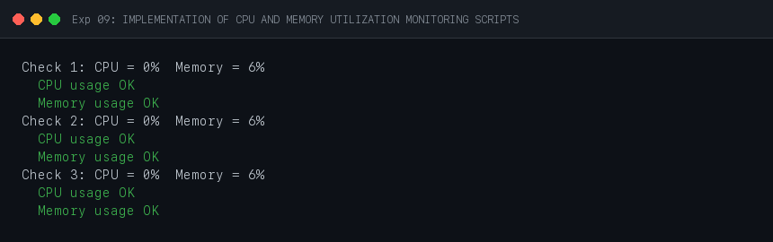

# Experiment 9: IMPLEMENTATION OF CPU AND MEMORY UTILIZATION MONITORING SCRIPTS

**Course Outcome:** CO1  
**Course Code:** CSA04 - Operating Systems  
**Student Name:** Rakul K (192525143)  

## AIM
To write a shell script that monitors CPU and memory utilisation and displays a warning when 
usage crosses a threshold.

## PROCEDURE
1. Set the threshold values for CPU and memory usage. 
2. Repeat the check three times with an interval of one second. 
3. Calculate CPU usage from the first line of /proc/stat taken at two instants. 
4. Calculate memory usage from the total and used values given by free. 
5. Display the usage and print a WARNING if it crosses the threshold, otherwise print OK.

## SOURCE CODE (script.sh)
```bash
#!/bin/bash 
CPU_LIMIT=80 
MEM_LIMIT=80 
  
cpu_usage() { 
    read -r _ u1 n1 s1 i1 _ < /proc/stat 
    sleep 1 
    read -r _ u2 n2 s2 i2 _ < /proc/stat 
    busy=$(( (u2 + n2 + s2) - (u1 + n1 + s1) )) 
    total=$(( busy + (i2 - i1) )) 
    [ $total -eq 0 ] && total=1 
    echo $(( 100 * busy / total )) 
} 
  
for check in 1 2 3; do 
    cpu=$(cpu_usage) 
    mem=$(free | awk '/Mem:/ {printf "%d", $3 * 100 / $2}') 
    echo "Check $check: CPU = ${cpu}%  Memory = ${mem}%" 
    if [ $cpu -gt $CPU_LIMIT ]; then echo "  WARNING: High CPU usage"; else echo "  CPU 
usage OK"; fi 
    if [ $mem -gt $MEM_LIMIT ]; then echo "  WARNING: High memory usage"; else echo "  
Memory usage OK"; fi 
done
```

## EXPECTED & VERIFIED OUTPUT
```
Check 1: CPU = 0%  Memory = 6% 
  CPU usage OK 
  Memory usage OK 
Check 2: CPU = 0%  Memory = 6% 
  CPU usage OK 
  Memory usage OK 
Check 3: CPU = 0%  Memory = 6% 
  CPU usage OK 
  Memory usage OK
```

## TERMINAL OUTPUT SCREENSHOT



## RESULT
Thus the shell script to monitor CPU and memory utilisation was executed successfully.
