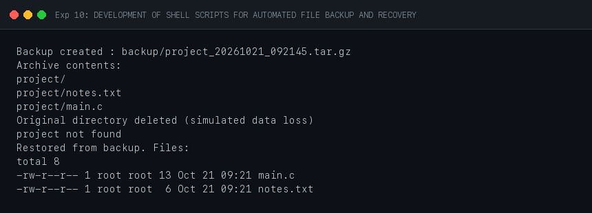

# Experiment 10: DEVELOPMENT OF SHELL SCRIPTS FOR AUTOMATED FILE BACKUP AND RECOVERY

**Course Outcome:** CO1  
**Course Code:** CSA04 - Operating Systems  
**Student Name:** Rakul K (192525143)  

## AIM
To write a shell script that takes a backup of a directory as a compressed archive and restores 
it when required.

## PROCEDURE
1. Create a sample directory with files to be backed up. 
2. Create a backup file name with the current date and time. 
3. Create the backup archive using tar -czf. 
4. List the contents of the archive using tar -tzf. 
5. Simulate data loss by deleting the original directory. 
6. Restore the directory by extracting the archive using tar -xzf and verify the files.

## SOURCE CODE (script.sh)
```bash
#!/bin/bash 
SRC=project 
BACKUP_DIR=backup 
mkdir -p $SRC $BACKUP_DIR 
echo "main program" > $SRC/main.c 
echo "notes" > $SRC/notes.txt 
  
FILE=$BACKUP_DIR/${SRC}_$(date +%Y%m%d_%H%M%S).tar.gz 
tar -czf $FILE $SRC 
echo "Backup created : $FILE" 
echo "Archive contents:" 
tar -tzf $FILE 
  
rm -rf $SRC 
echo "Original directory deleted (simulated data loss)" 
ls $SRC 2>/dev/null || echo "$SRC not found" 
  
tar -xzf $FILE 
echo "Restored from backup. Files:" 
ls -l $SRC
```

## EXPECTED & VERIFIED OUTPUT
```
Backup created : backup/project_20261021_092145.tar.gz 
Archive contents: 
project/ 
project/notes.txt 
project/main.c 
Original directory deleted (simulated data loss) 
project not found 
Restored from backup. Files: 
total 8 
-rw-r--r-- 1 root root 13 Oct 21 09:21 main.c 
-rw-r--r-- 1 root root  6 Oct 21 09:21 notes.txt
```

## TERMINAL OUTPUT SCREENSHOT



## RESULT
Thus the shell script for automated file backup and recovery was executed successfully.
