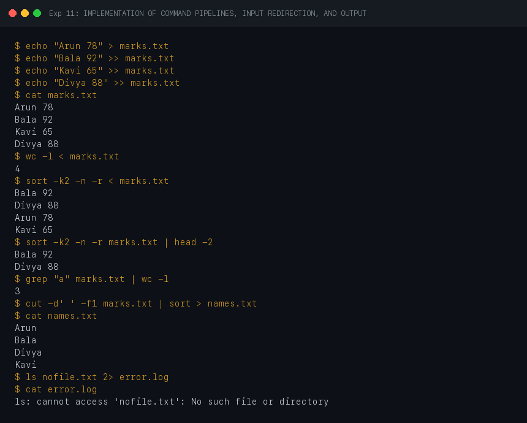

# Experiment 11: IMPLEMENTATION OF COMMAND PIPELINES, INPUT REDIRECTION, AND OUTPUT REDIRECTION

**Course Outcome:** CO1  
**Course Code:** CSA04 - Operating Systems  
**Student Name:** Rakul K (192525143)  

## AIM
To use command pipelines, input redirection and output redirection in Linux.

## PROCEDURE
1. Create a text file of student marks using output redirection (>). 
2. Append data to the file using >>. 
3. Use input redirection (<) to give the file as input to sort and wc. 
4. Use pipelines (|) to combine commands such as sort, head, grep, cut and wc. 
5. Redirect error messages to a file using 2>.

## SOURCE CODE (script.sh)
```bash
#!/usr/bin/env bash
# IMPLEMENTATION OF COMMAND PIPELINES, INPUT REDIRECTION, AND OUTPUT REDIRECTION
set -euo pipefail

echo "Arun 78" > marks.txt 
echo "Bala 92" >> marks.txt 
echo "Kavi 65" >> marks.txt 
echo "Divya 88" >> marks.txt 
cat marks.txt 
wc -l < marks.txt 
sort -k2 -n -r < marks.txt 
sort -k2 -n -r marks.txt | head -2 
grep "a" marks.txt | wc -l 
cut -d' ' -f1 marks.txt | sort > names.txt 
cat names.txt 
ls nofile.txt 2> error.log 
cat error.log
```

## EXPECTED & VERIFIED OUTPUT
```
$ echo "Arun 78" > marks.txt 
$ echo "Bala 92" >> marks.txt 
$ echo "Kavi 65" >> marks.txt 
$ echo "Divya 88" >> marks.txt 
$ cat marks.txt 
Arun 78 
Bala 92 
Kavi 65 
Divya 88 
$ wc -l < marks.txt 
4 
$ sort -k2 -n -r < marks.txt 
Bala 92 
Divya 88 
Arun 78 
Kavi 65 
$ sort -k2 -n -r marks.txt | head -2 
Bala 92 
Divya 88 
$ grep "a" marks.txt | wc -l 
3 
$ cut -d' ' -f1 marks.txt | sort > names.txt 
$ cat names.txt 
Arun 
Bala 
Divya 
Kavi 
$ ls nofile.txt 2> error.log 
$ cat error.log 
ls: cannot access 'nofile.txt': No such file or directory
```

## TERMINAL OUTPUT SCREENSHOT



## RESULT
Thus the command pipelines, input redirection and output redirection were executed 
successfully.
