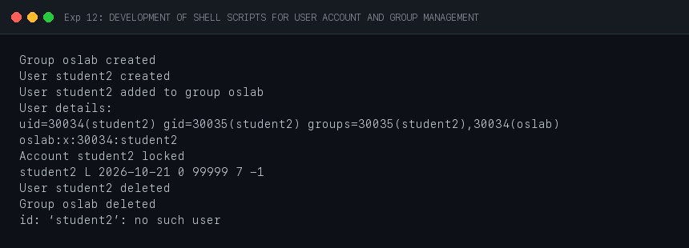

# Experiment 12: DEVELOPMENT OF SHELL SCRIPTS FOR USER ACCOUNT AND GROUP MANAGEMENT

**Course Outcome:** CO1  
**Course Code:** CSA04 - Operating Systems  
**Student Name:** Rakul K (192525143)  

## AIM
To write a shell script that creates and manages user accounts and groups in Linux.

## PROCEDURE
1. Run the script as the root user. 
2. Create a group using groupadd. 
3. Create a user using useradd and add the user to the group using usermod -aG. 
4. Display the user details using id and the group entry from /etc/group. 
5. Lock the user account using usermod -L and check the status using passwd -S. 
6. Delete the user and the group using userdel and groupdel.

## SOURCE CODE (script.sh)
```bash
#!/bin/bash 
GROUP=oslab 
USER=student2 
  
groupadd $GROUP && echo "Group $GROUP created" 
useradd -m $USER && echo "User $USER created" 
usermod -aG $GROUP $USER && echo "User $USER added to group $GROUP" 
  
echo "User details:" 
id $USER 
grep "^$GROUP:" /etc/group 
  
usermod -L $USER && echo "Account $USER locked" 
passwd -S $USER 
  
userdel -r $USER 2>/dev/null && echo "User $USER deleted" 
groupdel $GROUP && echo "Group $GROUP deleted" 
id $USER 2>&1
```

## EXPECTED & VERIFIED OUTPUT
```
Group oslab created 
User student2 created 
User student2 added to group oslab 
User details: 
uid=30034(student2) gid=30035(student2) groups=30035(student2),30034(oslab) 
oslab:x:30034:student2 
Account student2 locked 
student2 L 2026-10-21 0 99999 7 -1 
User student2 deleted 
Group oslab deleted 
id: ‘student2’: no such user
```

## TERMINAL OUTPUT SCREENSHOT



## RESULT
Thus the shell script for user account and group management was executed successfully.
