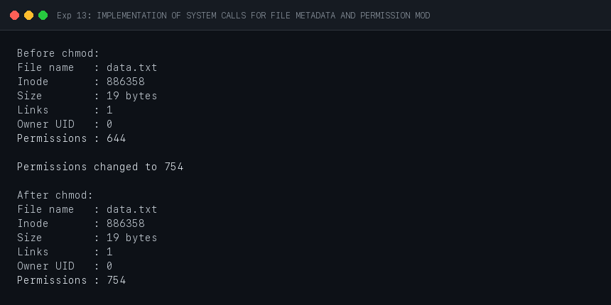

# Experiment 13: IMPLEMENTATION OF SYSTEM CALLS FOR FILE METADATA AND PERMISSION MODIFICATION

**Course Outcome:** CO1  
**Course Code:** CSA04 - Operating Systems  
**Student Name:** Rakul K (192525143)  

## AIM
To write a C program that retrieves file metadata using stat() and modifies file permissions 
using chmod().

## PROCEDURE
1. Create a sample file. 
2. Call stat() to get the file metadata. 
3. Display the inode number, size, number of links, owner ID and permissions. 
4. Change the permission of the file to 0754 using chmod(). 
5. Call stat() again and display the new permissions.

## SOURCE CODE (main.c)
```c
#include <stdio.h> 
#include <sys/stat.h> 
  
void show(char *name) 
{ 
    struct stat st; 
    if (stat(name, &st) < 0) { perror("stat"); return; } 
    printf("File name   : %s\n", name); 
    printf("Inode       : %lu\n", (unsigned long)st.st_ino); 
    printf("Size        : %ld bytes\n", (long)st.st_size); 
    printf("Links       : %lu\n", (unsigned long)st.st_nlink); 
    printf("Owner UID   : %d\n", st.st_uid); 
    printf("Permissions : %o\n\n", st.st_mode & 0777); 
} 
  
int main() 
{ 
    FILE *fp = fopen("data.txt", "w"); 
    fprintf(fp, "file metadata demo\n"); 
    fclose(fp); 
  
    printf("Before chmod:\n"); 
    show("data.txt"); 
    if (chmod("data.txt", 0754) == 0) 
        printf("Permissions changed to 754\n\n"); 
    printf("After chmod:\n"); 
    show("data.txt"); 
    return 0; 
}
```

## EXPECTED & VERIFIED OUTPUT
```
Before chmod: 
File name   : data.txt 
Inode       : 886358 
Size        : 19 bytes 
Links       : 1 
Owner UID   : 0 
Permissions : 644 
  
Permissions changed to 754 
  
After chmod: 
File name   : data.txt 
Inode       : 886358 
Size        : 19 bytes 
Links       : 1 
Owner UID   : 0 
Permissions : 754
```

## TERMINAL OUTPUT SCREENSHOT



## RESULT
Thus the C program to retrieve file metadata and modify permissions using system calls was 
executed successfully.
