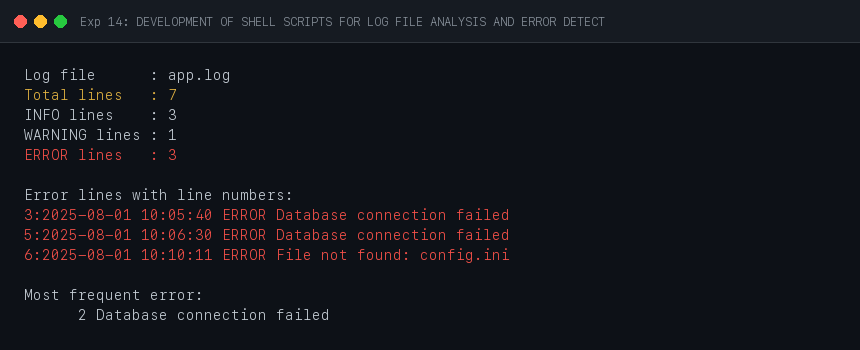

# Experiment 14: DEVELOPMENT OF SHELL SCRIPTS FOR LOG FILE ANALYSIS AND ERROR DETECTION

**Course Outcome:** CO1  
**Course Code:** CSA04 - Operating Systems  
**Student Name:** Rakul K (192525143)  

## AIM
To write a shell script that analyses a log file and reports the errors and warnings found in it.

## PROCEDURE
1. Create a sample log file containing INFO, WARNING and ERROR lines. 
2. Count the total number of lines using wc -l. 
3. Count the INFO, WARNING and ERROR lines using grep -c. 
4. Display all the ERROR lines with line numbers using grep -n. 
5. Find the most frequent error message using cut, sort and uniq -c. 
6. Display a summary report.

## SOURCE CODE (script.sh)
```bash
#!/bin/bash 
LOG=app.log 
cat > $LOG << EOF 
2025-08-01 10:00:01 INFO  Server started 
2025-08-01 10:02:15 WARNING Disk usage 85% 
2025-08-01 10:05:40 ERROR Database connection failed 
2025-08-01 10:06:02 INFO  Retrying connection 
2025-08-01 10:06:30 ERROR Database connection failed 
2025-08-01 10:10:11 ERROR File not found: config.ini 
2025-08-01 10:12:45 INFO  Request served 
EOF 
  
echo "Log file      : $LOG" 
echo "Total lines   : $(wc -l < $LOG)" 
echo "INFO lines    : $(grep -c 'INFO' $LOG)" 
echo "WARNING lines : $(grep -c 'WARNING' $LOG)" 
echo "ERROR lines   : $(grep -c 'ERROR' $LOG)" 
echo 
echo "Error lines with line numbers:" 
grep -n "ERROR" $LOG 
echo 
echo "Most frequent error:" 
grep "ERROR" $LOG | cut -d' ' -f4- | sort | uniq -c | sort -nr | head -1
```

## EXPECTED & VERIFIED OUTPUT
```
Log file      : app.log 
Total lines   : 7 
INFO lines    : 3 
WARNING lines : 1 
ERROR lines   : 3 
  
Error lines with line numbers: 
3:2025-08-01 10:05:40 ERROR Database connection failed 
5:2025-08-01 10:06:30 ERROR Database connection failed 
6:2025-08-01 10:10:11 ERROR File not found: config.ini 
  
Most frequent error: 
      2 Database connection failed
```

## TERMINAL OUTPUT SCREENSHOT



## RESULT
Thus the shell script for log file analysis and error detection was executed successfully.
