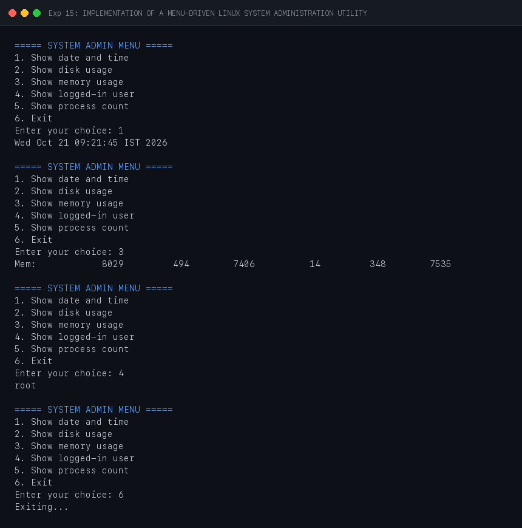

# Experiment 15: IMPLEMENTATION OF A MENU-DRIVEN LINUX SYSTEM ADMINISTRATION UTILITY

**Course Outcome:** CO1  
**Course Code:** CSA04 - Operating Systems  
**Student Name:** Rakul K (192525143)  

## AIM
To develop a menu -driven shell script that performs common Linux system administration 
tasks.

## PROCEDURE
1. Display a menu with options: date, disk usage, memory usage, logged -in users, running 
processes and exit. 
2. Read the choice of the user. 
3. Use a case statement to execute the command for the chosen option. 
4. Repeat the menu using a while loop until the user selects Exit.

## SOURCE CODE (script.sh)
```bash
#!/bin/bash 
while true; do 
    echo "===== SYSTEM ADMIN MENU =====" 
    echo "1. Show date and time" 
    echo "2. Show disk usage" 
    echo "3. Show memory usage" 
    echo "4. Show logged-in user" 
    echo "5. Show process count" 
    echo "6. Exit" 
    echo -n "Enter your choice: " 
    read ch 
    case $ch in 
        1) date ;; 
        2) df -h / | tail -1 ;; 
        3) free -m | grep Mem ;; 
        4) whoami ;; 
        5) echo "Running processes: $(ps -e --no-headers | wc -l)" ;; 
        6) echo "Exiting..."; break ;; 
        *) echo "Invalid choice" ;; 
    esac 
    echo 
done
```

## INPUT DATA
```
1 
3 
4 
6
```

## EXPECTED & VERIFIED OUTPUT
```
===== SYSTEM ADMIN MENU ===== 
1. Show date and time 
2. Show disk usage 
3. Show memory usage 
4. Show logged-in user 
5. Show process count 
6. Exit 
Enter your choice: 1 
Wed Oct 21 09:21:45 IST 2026 
  
===== SYSTEM ADMIN MENU ===== 
1. Show date and time 
2. Show disk usage 
3. Show memory usage 
4. Show logged-in user 
5. Show process count 
6. Exit 
Enter your choice: 3 
Mem:            8029         494        7406          14         348        7535 
  
===== SYSTEM ADMIN MENU ===== 
1. Show date and time 
2. Show disk usage 
3. Show memory usage 
4. Show logged-in user 
5. Show process count 
6. Exit 
Enter your choice: 4 
root 
  
===== SYSTEM ADMIN MENU ===== 
1. Show date and time 
2. Show disk usage 
3. Show memory usage 
4. Show logged-in user 
5. Show process count 
6. Exit 
Enter your choice: 6 
Exiting...
```

## TERMINAL OUTPUT SCREENSHOT



## RESULT
Thus the menu-driven Linux system administration utility was executed successfully.
