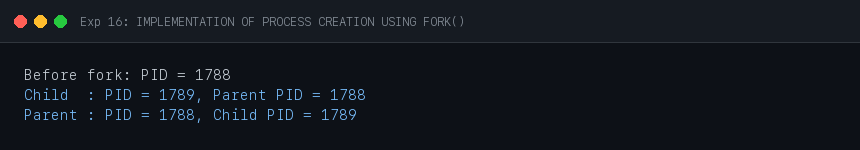

# Experiment 16: IMPLEMENTATION OF PROCESS CREATION USING FORK()

**Course Outcome:** CO2  
**Course Code:** CSA04 - Operating Systems  
**Student Name:** Rakul K (192525143)  

## AIM
To write a C program that creates a new process using the fork() system call and displays the 
process IDs of the parent and the child.

## PROCEDURE
1. Include <unistd.h> and <sys/wait.h>. 
2. Call fork() to create a child process. 
3. If fork() returns a negative value, display an error. 
4. If fork() returns 0, the code is running in the child: display the child's PID and its parent's 
PID. 
5. Otherwise the code is running in the parent: display the parent's PID and the child's PID 
returned by fork(). 
6. The parent waits for the child to finish using wait().

## SOURCE CODE (main.c)
```c
#include <stdio.h> 
#include <unistd.h> 
#include <sys/wait.h> 
  
int main() 
{ 
    pid_t pid; 
    printf("Before fork: PID = %d\n", getpid()); 
    pid = fork(); 
    if (pid < 0) { 
        printf("Fork failed\n"); 
    } else if (pid == 0) { 
        printf("Child  : PID = %d, Parent PID = %d\n", getpid(), getppid()); 
    } else { 
        wait(NULL); 
        printf("Parent : PID = %d, Child PID = %d\n", getpid(), pid); 
    } 
    return 0; 
}
```

## EXPECTED & VERIFIED OUTPUT
```
Before fork: PID = 1788 
Child  : PID = 1789, Parent PID = 1788 
Parent : PID = 1788, Child PID = 1789
```

## TERMINAL OUTPUT SCREENSHOT



## RESULT
Thus the C program to create a process using fork() was executed successfully.
