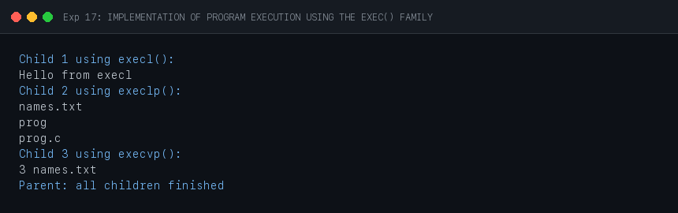

# Experiment 17: IMPLEMENTATION OF PROGRAM EXECUTION USING THE EXEC() FAMILY

**Course Outcome:** CO2  
**Course Code:** CSA04 - Operating Systems  
**Student Name:** Rakul K (192525143)  

## AIM
To write a C program that executes other programs from a child process using the exec() family 
of system calls.

## PROCEDURE
1. Create three child processes one after another using fork(). 
2. In the first child, run the echo command using execl() with the full path /bin/echo. 
3. In the second child, run the ls command using execlp(), which searches the PATH. 
4. In the third child, run the wc command using execvp() with an argument array. 
5. If exec() returns, print an error because exec() returns only on failure. 
6. In the parent, wait for each child before creating the next one.

## SOURCE CODE (main.c)
```c
#include <stdio.h> 
#include <unistd.h> 
#include <sys/wait.h> 
  
int main() 
{ 
    char *args[] = {"wc", "-l", "names.txt", NULL}; 
  
    if (fork() == 0) { 
        printf("Child 1 using execl():\n"); 
        fflush(stdout); 
        execl("/bin/echo", "echo", "Hello from execl", NULL); 
        perror("execl"); 
    } 
    wait(NULL); 
  
    if (fork() == 0) { 
        printf("Child 2 using execlp():\n"); 
        fflush(stdout); 
        execlp("ls", "ls", "-1", NULL); 
        perror("execlp"); 
    } 
    wait(NULL); 
  
    if (fork() == 0) { 
        printf("Child 3 using execvp():\n"); 
        fflush(stdout); 
        execvp(args[0], args); 
        perror("execvp"); 
    } 
    wait(NULL); 
    printf("Parent: all children finished\n"); 
    return 0; 
}
```

## EXPECTED & VERIFIED OUTPUT
```
Child 1 using execl(): 
Hello from execl 
Child 2 using execlp(): 
names.txt 
prog 
prog.c 
Child 3 using execvp(): 
3 names.txt 
Parent: all children finished
```

## TERMINAL OUTPUT SCREENSHOT



## RESULT
Thus the C program to execute programs using the exec() family of system calls was executed 
successfully.
