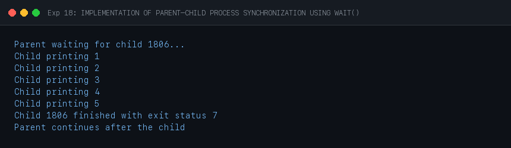

# Experiment 18: IMPLEMENTATION OF PARENT–CHILD PROCESS SYNCHRONIZATION USING WAIT()

**Course Outcome:** CO2  
**Course Code:** CSA04 - Operating Systems  
**Student Name:** Rakul K (192525143)  

## AIM
To write a C program that synchronises a parent and a child process using the wait() system 
call.

## PROCEDURE
1. Create a child process using fork(). 
2. In the child, print the numbers 1 to 5 and exit with status 7 using exit(). 
3. In the parent, call wait() so that the parent is blocked until the child terminates. 
4. After wait() returns, check WIFEXITED() and display the exit status using 
WEXITSTATUS(). 
5. Display a message from the parent after the child has finished.

## SOURCE CODE (main.c)
```c
#include <stdio.h> 
#include <stdlib.h> 
#include <unistd.h> 
#include <sys/wait.h> 
  
int main() 
{ 
    int status, i; 
    pid_t pid = fork(); 
  
    if (pid == 0) { 
        for (i = 1; i <= 5; i++) 
            printf("Child printing %d\n", i); 
        exit(7); 
    } else { 
        printf("Parent waiting for child %d...\n", pid); 
        fflush(stdout); 
        pid_t done = wait(&status); 
        if (WIFEXITED(status)) 
            printf("Child %d finished with exit status %d\n", done, 
WEXITSTATUS(status)); 
        printf("Parent continues after the child\n"); 
    } 
    return 0; 
}
```

## EXPECTED & VERIFIED OUTPUT
```
Parent waiting for child 1806... 
Child printing 1 
Child printing 2 
Child printing 3 
Child printing 4 
Child printing 5 
Child 1806 finished with exit status 7 
Parent continues after the child
```

## TERMINAL OUTPUT SCREENSHOT



## RESULT
Thus the C program to synchronise parent and child processes using wait() was executed 
successfully.
