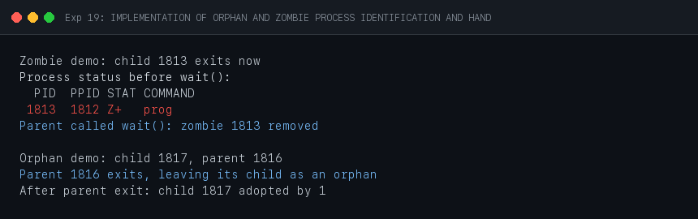

# Experiment 19: IMPLEMENTATION OF ORPHAN AND ZOMBIE PROCESS IDENTIFICATION AND HANDLING

**Course Outcome:** CO2  
**Course Code:** CSA04 - Operating Systems  
**Student Name:** Rakul K (192525143)  

## AIM
To write a C program that creates a zombie process and an orphan process, identifies them and 
handles them.

## PROCEDURE
1. Zombie: create a child that exits immediately while the parent sleeps without calling 
wait(). 
2. Display the process table using ps; the child is shown with state Z (zombie). 
3. Handle the zombie by calling wait() in the parent, which removes its entry. 
4. Orphan: create a process whose parent exits before it. 
5. The orphan child sleeps, then prints its new parent PID, showing that it was adopted by 
another process (init or a sub-reaper).

## SOURCE CODE (main.c)
```c
#include <stdio.h> 
#include <stdlib.h> 
#include <unistd.h> 
#include <sys/wait.h> 
  
int main() 
{ 
    pid_t pid; 
    char cmd[100]; 
  
    /* ----- Zombie process ----- */ 
    pid = fork(); 
    if (pid == 0) { 
        printf("Zombie demo: child %d exits now\n", getpid()); 
        exit(0); 
    } 
    sleep(1); 
    sprintf(cmd, "ps -o pid,ppid,stat,comm -p %d", pid); 
    printf("Process status before wait():\n"); 
    fflush(stdout); 
    system(cmd); 
    wait(NULL); 
    printf("Parent called wait(): zombie %d removed\n\n", pid); 
  
    /* ----- Orphan process ----- */ 
    pid = fork(); 
    if (pid == 0) { 
        if (fork() == 0) { 
            printf("Orphan demo: child %d, parent %d\n", getpid(), getppid()); 
            fflush(stdout); 
            sleep(2); 
            printf("After parent exit: child %d adopted by %d\n", getpid(), getppid()); 
            exit(0); 
        } 
        sleep(1); 
        printf("Parent %d exits, leaving its child as an orphan\n", getpid()); 
        exit(0); 
    } 
    wait(NULL); 
    sleep(3); 
    return 0; 
}
```

## EXPECTED & VERIFIED OUTPUT
```
Zombie demo: child 1813 exits now 
Process status before wait(): 
  PID  PPID STAT COMMAND 
 1813  1812 Z+   prog 
Parent called wait(): zombie 1813 removed 
  
Orphan demo: child 1817, parent 1816 
Parent 1816 exits, leaving its child as an orphan 
After parent exit: child 1817 adopted by 1
```

## TERMINAL OUTPUT SCREENSHOT



## RESULT
Thus the zombie and orphan processes were created, identified and handled successfully.
