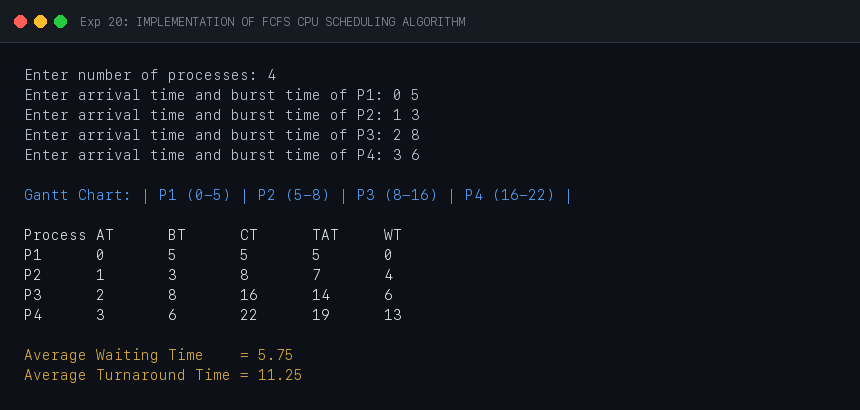

# Experiment 20: IMPLEMENTATION OF FCFS CPU SCHEDULING ALGORITHM

**Course Outcome:** CO2  
**Course Code:** CSA04 - Operating Systems  
**Student Name:** Rakul K (192525143)  

## AIM
To write a C program to implement the First Come First Served (FCFS) CPU scheduling 
algorithm and find the average waiting time and turnaround time.

## PROCEDURE
1. Read the number of processes and the arrival time and burst time of each process. 
2. Sort the processes in the order of their arrival time. 
3. Start with time = 0. For each process, if the CPU is idle before it arrives, move the time 
to its arrival time. 
4. Completion time = current time + burst time. 
5. Turnaround time = completion time - arrival time; waiting time = turnaround time - burst 
time. 
6. Display the Gantt chart, the table and the average waiting and turnaround times.

## SOURCE CODE (main.c)
```c
#include <stdio.h> 
  
int main() 
{ 
    int n, i, j, at[10], bt[10], ct[10], tat[10], wt[10], p[10], t; 
    float twt = 0, ttat = 0; 
  
    printf("Enter number of processes: "); 
    scanf("%d", &n); 
    for (i = 0; i < n; i++) { 
        printf("Enter arrival time and burst time of P%d: ", i + 1); 
        scanf("%d %d", &at[i], &bt[i]); 
        p[i] = i + 1; 
    } 
    /* sort by arrival time */ 
    for (i = 0; i < n - 1; i++) 
        for (j = 0; j < n - i - 1; j++) 
            if (at[j] > at[j + 1]) { 
                t = at[j]; at[j] = at[j + 1]; at[j + 1] = t; 
                t = bt[j]; bt[j] = bt[j + 1]; bt[j + 1] = t; 
                t = p[j];  p[j]  = p[j + 1];  p[j + 1]  = t; 
            } 
    t = 0; 
    printf("\nGantt Chart: "); 
    for (i = 0; i < n; i++) { 
        if (t < at[i]) t = at[i]; 
        printf("| P%d (%d-%d) ", p[i], t, t + bt[i]); 
        t += bt[i]; 
        ct[i] = t; 
        tat[i] = ct[i] - at[i]; 
        wt[i] = tat[i] - bt[i]; 
        twt += wt[i]; 
        ttat += tat[i]; 
    } 
    printf("|\n\nProcess\tAT\tBT\tCT\tTAT\tWT\n"); 
    for (i = 0; i < n; i++) 
        printf("P%d\t%d\t%d\t%d\t%d\t%d\n", p[i], at[i], bt[i], ct[i], tat[i], wt[i]); 
    printf("\nAverage Waiting Time    = %.2f\n", twt / n); 
    printf("Average Turnaround Time = %.2f\n", ttat / n); 
    return 0; 
}
```

## INPUT DATA
```
4 
0 5 
1 3 
2 8 
3 6
```

## EXPECTED & VERIFIED OUTPUT
```
Enter number of processes: 4 
Enter arrival time and burst time of P1: 0 5 
Enter arrival time and burst time of P2: 1 3 
Enter arrival time and burst time of P3: 2 8 
Enter arrival time and burst time of P4: 3 6 
  
Gantt Chart: | P1 (0-5) | P2 (5-8) | P3 (8-16) | P4 (16-22) | 
  
Process AT      BT      CT      TAT     WT 
P1      0       5       5       5       0 
P2      1       3       8       7       4 
P3      2       8       16      14      6 
P4      3       6       22      19      13 
  
Average Waiting Time    = 5.75 
Average Turnaround Time = 11.25
```

## TERMINAL OUTPUT SCREENSHOT



## RESULT
Thus the C program to implement FCFS CPU scheduling was executed successfully and the 
average waiting time and turnaround time were calculated.
