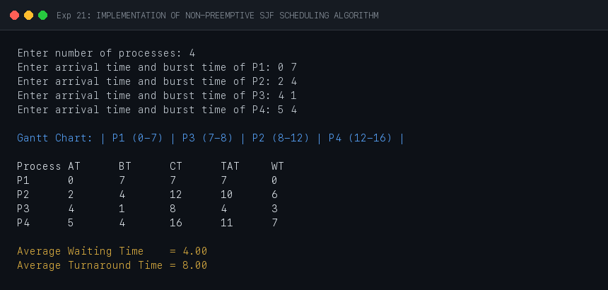

# Experiment 21: IMPLEMENTATION OF NON-PREEMPTIVE SJF SCHEDULING ALGORITHM

**Course Outcome:** CO2  
**Course Code:** CSA04 - Operating Systems  
**Student Name:** Rakul K (192525143)  

## AIM
To write a C program to implement the non -preemptive Shortest Job First (SJF) CPU 
scheduling algorithm.

## PROCEDURE
1. Read the number of processes and the arrival time and burst time of each process. 
2. Set time = 0 and mark all processes as not completed. 
3. Among the processes that have arrived and are not completed, select the one with the 
smallest burst time. 
4. If no process has arrived, increase the time by 1. 
5. Run the selected process to completion and compute its completion, turnaround and 
waiting times. 
6. Repeat until all processes are completed, then display the results and averages.

## SOURCE CODE (main.c)
```c
#include <stdio.h> 
  
int main() 
{ 
    int n, i, at[10], bt[10], ct[10], tat[10], wt[10], done[10] = {0}; 
    int t = 0, completed = 0, k; 
    float twt = 0, ttat = 0; 
  
    printf("Enter number of processes: "); 
    scanf("%d", &n); 
    for (i = 0; i < n; i++) { 
        printf("Enter arrival time and burst time of P%d: ", i + 1); 
        scanf("%d %d", &at[i], &bt[i]); 
    } 
    printf("\nGantt Chart: "); 
    while (completed < n) { 
        k = -1; 
        for (i = 0; i < n; i++) 
            if (!done[i] && at[i] <= t && (k == -1 || bt[i] < bt[k])) 
                k = i; 
        if (k == -1) { t++; continue; } 
        printf("| P%d (%d-%d) ", k + 1, t, t + bt[k]); 
        t += bt[k]; 
        ct[k] = t; 
        tat[k] = ct[k] - at[k]; 
        wt[k] = tat[k] - bt[k]; 
        done[k] = 1; 
        completed++; 
    } 
    printf("|\n\nProcess\tAT\tBT\tCT\tTAT\tWT\n"); 
    for (i = 0; i < n; i++) { 
        printf("P%d\t%d\t%d\t%d\t%d\t%d\n", i + 1, at[i], bt[i], ct[i], tat[i], wt[i]); 
        twt += wt[i]; 
        ttat += tat[i]; 
    } 
    printf("\nAverage Waiting Time    = %.2f\n", twt / n); 
    printf("Average Turnaround Time = %.2f\n", ttat / n); 
    return 0; 
}
```

## INPUT DATA
```
4 
0 7 
2 4 
4 1 
5 4
```

## EXPECTED & VERIFIED OUTPUT
```
Enter number of processes: 4 
Enter arrival time and burst time of P1: 0 7 
Enter arrival time and burst time of P2: 2 4 
Enter arrival time and burst time of P3: 4 1 
Enter arrival time and burst time of P4: 5 4 
  
Gantt Chart: | P1 (0-7) | P3 (7-8) | P2 (8-12) | P4 (12-16) | 
  
Process AT      BT      CT      TAT     WT 
P1      0       7       7       7       0 
P2      2       4       12      10      6 
P3      4       1       8       4       3 
P4      5       4       16      11      7 
  
Average Waiting Time    = 4.00 
Average Turnaround Time = 8.00
```

## TERMINAL OUTPUT SCREENSHOT



## RESULT
Thus the C program to implement non-preemptive SJF scheduling was executed successfully.
