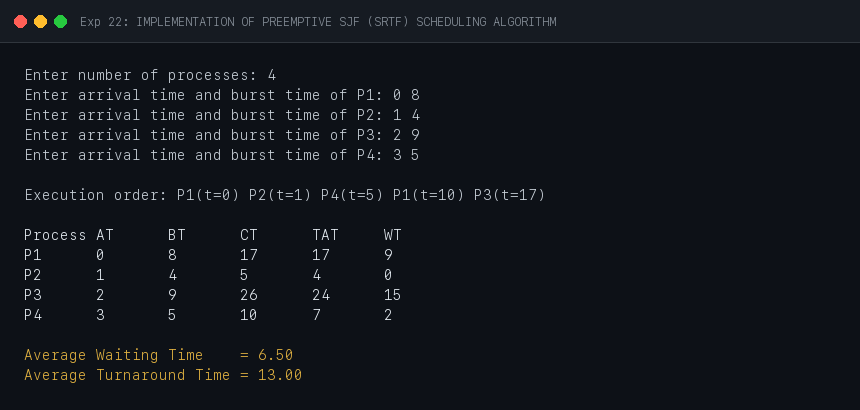

# Experiment 22: IMPLEMENTATION OF PREEMPTIVE SJF (SRTF) SCHEDULING ALGORITHM

**Course Outcome:** CO2  
**Course Code:** CSA04 - Operating Systems  
**Student Name:** Rakul K (192525143)  

## AIM
To write a C program to implement the preemptive Shortest Job First, also called Shortest 
Remaining Time First (SRTF), scheduling algorithm.

## PROCEDURE
1. Read the number of processes and the arrival time and burst time of each process. 
2. Copy the burst times into a remaining-time array. 
3. At every time unit, select the arrived process with the smallest remaining time. 
4. Execute the selected process for one time unit and decrease its remaining time. 
5. When the remaining time becomes 0, record the completion time. 
6. Repeat until all processes complete; compute turnaround and waiting times and the 
averages.

## SOURCE CODE (main.c)
```c
#include <stdio.h> 
  
int main() 
{ 
    int n, i, at[10], bt[10], rt[10], ct[10], tat[10], wt[10]; 
    int t = 0, completed = 0, k, prev = -1; 
    float twt = 0, ttat = 0; 
  
    printf("Enter number of processes: "); 
    scanf("%d", &n); 
    for (i = 0; i < n; i++) { 
        printf("Enter arrival time and burst time of P%d: ", i + 1); 
        scanf("%d %d", &at[i], &bt[i]); 
        rt[i] = bt[i]; 
    } 
    printf("\nExecution order: "); 
    while (completed < n) { 
        k = -1; 
        for (i = 0; i < n; i++) 
            if (at[i] <= t && rt[i] > 0 && (k == -1 || rt[i] < rt[k])) 
                k = i; 
        if (k == -1) { t++; continue; } 
        if (k != prev) { printf("P%d(t=%d) ", k + 1, t); prev = k; } 
        rt[k]--; 
        t++; 
        if (rt[k] == 0) { 
            ct[k] = t; 
            completed++; 
        } 
    } 
    printf("\n\nProcess\tAT\tBT\tCT\tTAT\tWT\n"); 
    for (i = 0; i < n; i++) { 
        tat[i] = ct[i] - at[i]; 
        wt[i] = tat[i] - bt[i]; 
        twt += wt[i]; 
        ttat += tat[i]; 
        printf("P%d\t%d\t%d\t%d\t%d\t%d\n", i + 1, at[i], bt[i], ct[i], tat[i], wt[i]); 
    } 
    printf("\nAverage Waiting Time    = %.2f\n", twt / n); 
    printf("Average Turnaround Time = %.2f\n", ttat / n); 
    return 0; 
}
```

## INPUT DATA
```
4 
0 8 
1 4 
2 9 
3 5
```

## EXPECTED & VERIFIED OUTPUT
```
Enter number of processes: 4 
Enter arrival time and burst time of P1: 0 8 
Enter arrival time and burst time of P2: 1 4 
Enter arrival time and burst time of P3: 2 9 
Enter arrival time and burst time of P4: 3 5 
  
Execution order: P1(t=0) P2(t=1) P4(t=5) P1(t=10) P3(t=17) 
  
Process AT      BT      CT      TAT     WT 
P1      0       8       17      17      9 
P2      1       4       5       4       0 
P3      2       9       26      24      15 
P4      3       5       10      7       2 
  
Average Waiting Time    = 6.50 
Average Turnaround Time = 13.00
```

## TERMINAL OUTPUT SCREENSHOT



## RESULT
Thus the C program to implement SRTF (preemptive SJF) scheduling was executed 
successfully.
