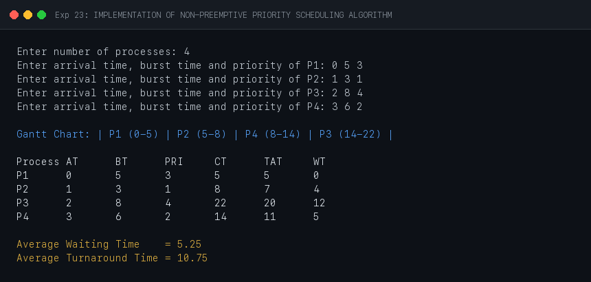

# Experiment 23: IMPLEMENTATION OF NON-PREEMPTIVE PRIORITY SCHEDULING ALGORITHM

**Course Outcome:** CO2  
**Course Code:** CSA04 - Operating Systems  
**Student Name:** Rakul K (192525143)  

## AIM
To write a C program to implement the non -preemptive priority CPU scheduling algorithm 
(lower number means higher priority).

## PROCEDURE
1. Read the number of processes and the arrival time, burst time and priority of each process. 
2. Set time = 0. 
3. Among the arrived processes that are not completed, select the one with the highest 
priority (smallest priority number). 
4. Run the selected process until it completes and record its completion time. 
5. Repeat until all processes are completed. 
6. Compute turnaround and waiting times, display the table and the averages.

## SOURCE CODE (main.c)
```c
#include <stdio.h> 
  
int main() 
{ 
    int n, i, at[10], bt[10], pr[10], ct[10], tat[10], wt[10], done[10] = {0}; 
    int t = 0, completed = 0, k; 
    float twt = 0, ttat = 0; 
  
    printf("Enter number of processes: "); 
    scanf("%d", &n); 
    for (i = 0; i < n; i++) { 
        printf("Enter arrival time, burst time and priority of P%d: ", i + 1); 
        scanf("%d %d %d", &at[i], &bt[i], &pr[i]); 
    } 
    printf("\nGantt Chart: "); 
    while (completed < n) { 
        k = -1; 
        for (i = 0; i < n; i++) 
            if (!done[i] && at[i] <= t && (k == -1 || pr[i] < pr[k])) 
                k = i; 
        if (k == -1) { t++; continue; } 
        printf("| P%d (%d-%d) ", k + 1, t, t + bt[k]); 
        t += bt[k]; 
        ct[k] = t; 
        done[k] = 1; 
        completed++; 
    } 
    printf("|\n\nProcess\tAT\tBT\tPRI\tCT\tTAT\tWT\n"); 
    for (i = 0; i < n; i++) { 
        tat[i] = ct[i] - at[i]; 
        wt[i] = tat[i] - bt[i]; 
        twt += wt[i]; 
        ttat += tat[i]; 
        printf("P%d\t%d\t%d\t%d\t%d\t%d\t%d\n", i + 1, at[i], bt[i], pr[i], ct[i], 
tat[i], wt[i]); 
    } 
    printf("\nAverage Waiting Time    = %.2f\n", twt / n); 
    printf("Average Turnaround Time = %.2f\n", ttat / n); 
    return 0; 
}
```

## INPUT DATA
```
4 
0 5 3 
1 3 1 
2 8 4 
3 6 2
```

## EXPECTED & VERIFIED OUTPUT
```
Enter number of processes: 4 
Enter arrival time, burst time and priority of P1: 0 5 3 
Enter arrival time, burst time and priority of P2: 1 3 1 
Enter arrival time, burst time and priority of P3: 2 8 4 
Enter arrival time, burst time and priority of P4: 3 6 2 
  
Gantt Chart: | P1 (0-5) | P2 (5-8) | P4 (8-14) | P3 (14-22) | 
  
Process AT      BT      PRI     CT      TAT     WT 
P1      0       5       3       5       5       0 
P2      1       3       1       8       7       4 
P3      2       8       4       22      20      12 
P4      3       6       2       14      11      5 
  
Average Waiting Time    = 5.25 
Average Turnaround Time = 10.75
```

## TERMINAL OUTPUT SCREENSHOT



## RESULT
Thus the C program to implement non -preemptive priority scheduling was executed 
successfully.
