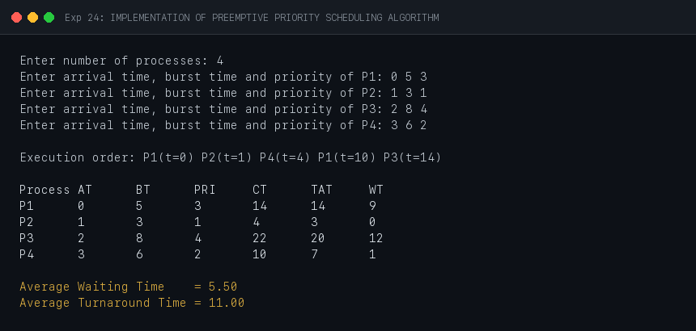

# Experiment 24: IMPLEMENTATION OF PREEMPTIVE PRIORITY SCHEDULING ALGORITHM

**Course Outcome:** CO2  
**Course Code:** CSA04 - Operating Systems  
**Student Name:** Rakul K (192525143)  

## AIM
To write a C program to implement the preemptive priority CPU scheduling algorithm (lower 
number means higher priority).

## PROCEDURE
1. Read the number of processes and the arrival time, burst time and priority of each process. 
2. Copy the burst times into a remaining-time array. 
3. At every time unit, select the arrived process with the highest priority that still has 
remaining time. 
4. Run it for one time unit; a newly arrived process with higher priority preempts the running 
process. 
5. When the remaining time of a process becomes 0, record its completion time. 
6. Compute turnaround and waiting times, display the table and the averages.

## SOURCE CODE (main.c)
```c
#include <stdio.h> 
  
int main() 
{ 
    int n, i, at[10], bt[10], pr[10], rt[10], ct[10], tat, wt; 
    int t = 0, completed = 0, k, prev = -1; 
    float twt = 0, ttat = 0; 
  
    printf("Enter number of processes: "); 
    scanf("%d", &n); 
    for (i = 0; i < n; i++) { 
        printf("Enter arrival time, burst time and priority of P%d: ", i + 1); 
        scanf("%d %d %d", &at[i], &bt[i], &pr[i]); 
        rt[i] = bt[i]; 
    } 
    printf("\nExecution order: "); 
    while (completed < n) { 
        k = -1; 
        for (i = 0; i < n; i++) 
            if (at[i] <= t && rt[i] > 0 && (k == -1 || pr[i] < pr[k])) 
                k = i; 
        if (k == -1) { t++; continue; } 
        if (k != prev) { printf("P%d(t=%d) ", k + 1, t); prev = k; } 
        rt[k]--; 
        t++; 
        if (rt[k] == 0) { ct[k] = t; completed++; } 
    } 
    printf("\n\nProcess\tAT\tBT\tPRI\tCT\tTAT\tWT\n"); 
    for (i = 0; i < n; i++) { 
        tat = ct[i] - at[i]; 
        wt = tat - bt[i]; 
        twt += wt; 
        ttat += tat; 
        printf("P%d\t%d\t%d\t%d\t%d\t%d\t%d\n", i + 1, at[i], bt[i], pr[i], ct[i], tat, 
wt); 
    } 
    printf("\nAverage Waiting Time    = %.2f\n", twt / n); 
    printf("Average Turnaround Time = %.2f\n", ttat / n); 
    return 0; 
}
```

## INPUT DATA
```
4 
0 5 3 
1 3 1 
2 8 4 
3 6 2
```

## EXPECTED & VERIFIED OUTPUT
```
Enter number of processes: 4 
Enter arrival time, burst time and priority of P1: 0 5 3 
Enter arrival time, burst time and priority of P2: 1 3 1 
Enter arrival time, burst time and priority of P3: 2 8 4 
Enter arrival time, burst time and priority of P4: 3 6 2 
  
Execution order: P1(t=0) P2(t=1) P4(t=4) P1(t=10) P3(t=14) 
  
Process AT      BT      PRI     CT      TAT     WT 
P1      0       5       3       14      14      9 
P2      1       3       1       4       3       0 
P3      2       8       4       22      20      12 
P4      3       6       2       10      7       1 
  
Average Waiting Time    = 5.50 
Average Turnaround Time = 11.00
```

## TERMINAL OUTPUT SCREENSHOT



## RESULT
Thus the C program to implement preemptive priority scheduling was executed successfully.
