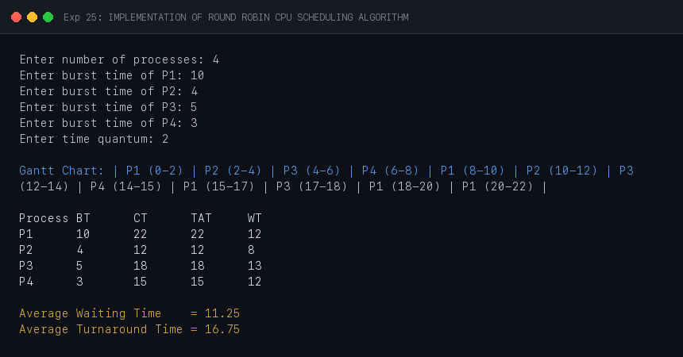

# Experiment 25: IMPLEMENTATION OF ROUND ROBIN CPU SCHEDULING ALGORITHM

**Course Outcome:** CO2  
**Course Code:** CSA04 - Operating Systems  
**Student Name:** Rakul K (192525143)  

## AIM
To write a C program to implement the Round Robin CPU scheduling algorithm with a given 
time quantum.

## PROCEDURE
1. Read the number of processes, the burst time of each process and the time quantum (all 
processes arrive at time 0). 
2. Copy the burst times into a remaining-time array. 
3. Visit the processes in circular order. If the remaining time is more than the quantum, run 
the process for one quantum. 
4. Otherwise run it for its remaining time and record its completion time. 
5. Repeat until all processes are completed. 
6. Waiting time = completion time - burst time; display the table and the averages.

## SOURCE CODE (main.c)
```c
#include <stdio.h> 
  
int main() 
{ 
    int n, i, q, bt[10], rt[10], ct[10], t = 0, left; 
    float twt = 0, ttat = 0; 
  
    printf("Enter number of processes: "); 
    scanf("%d", &n); 
    for (i = 0; i < n; i++) { 
        printf("Enter burst time of P%d: ", i + 1); 
        scanf("%d", &bt[i]); 
        rt[i] = bt[i]; 
    } 
    printf("Enter time quantum: "); 
    scanf("%d", &q); 
  
    left = n; 
    printf("\nGantt Chart: "); 
    while (left > 0) { 
        for (i = 0; i < n; i++) { 
            if (rt[i] == 0) continue; 
            int run = rt[i] > q ? q : rt[i]; 
            printf("| P%d (%d-%d) ", i + 1, t, t + run); 
            t += run; 
            rt[i] -= run; 
            if (rt[i] == 0) { ct[i] = t; left--; } 
        } 
    } 
    printf("|\n\nProcess\tBT\tCT\tTAT\tWT\n"); 
    for (i = 0; i < n; i++) { 
        int tat = ct[i], wt = ct[i] - bt[i]; 
        twt += wt; 
        ttat += tat; 
        printf("P%d\t%d\t%d\t%d\t%d\n", i + 1, bt[i], ct[i], tat, wt); 
    } 
    printf("\nAverage Waiting Time    = %.2f\n", twt / n); 
    printf("Average Turnaround Time = %.2f\n", ttat / n); 
    return 0; 
}
```

## INPUT DATA
```
4 
10 
4 
5 
3 
2
```

## EXPECTED & VERIFIED OUTPUT
```
Enter number of processes: 4 
Enter burst time of P1: 10 
Enter burst time of P2: 4 
Enter burst time of P3: 5 
Enter burst time of P4: 3 
Enter time quantum: 2 
  
Gantt Chart: | P1 (0-2) | P2 (2-4) | P3 (4-6) | P4 (6-8) | P1 (8-10) | P2 (10-12) | P3 
(12-14) | P4 (14-15) | P1 (15-17) | P3 (17-18) | P1 (18-20) | P1 (20-22) | 
  
Process BT      CT      TAT     WT 
P1      10      22      22      12 
P2      4       12      12      8 
P3      5       18      18      13 
P4      3       15      15      12 
  
Average Waiting Time    = 11.25 
Average Turnaround Time = 16.75
```

## TERMINAL OUTPUT SCREENSHOT



## RESULT
Thus the C program to implement Round Robin scheduling was executed successfully.
