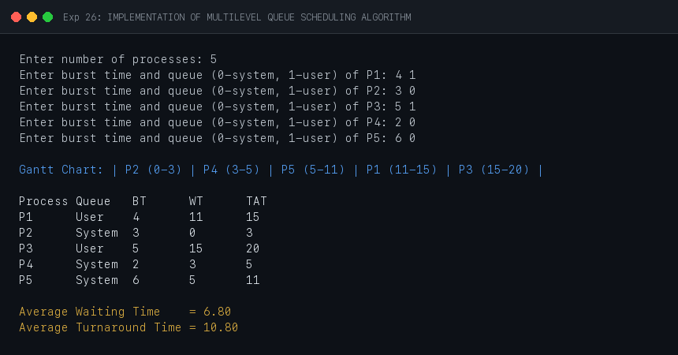

# Experiment 26: IMPLEMENTATION OF MULTILEVEL QUEUE SCHEDULING ALGORITHM

**Course Outcome:** CO2  
**Course Code:** CSA04 - Operating Systems  
**Student Name:** Rakul K (192525143)  

## AIM
To write a C program to implement Multilevel Queue scheduling with a system (foreground) 
queue and a user (background) queue.

## PROCEDURE
1. Read the number of processes, the burst time of each process and its queue (0 = system, 
1 = user). 
2. All processes arrive at time 0. 
3. The system queue has absolute priority over the user queue. 
4. Schedule all processes of the system queue first in FCFS order. 
5. Then schedule the processes of the user queue in FCFS order. 
6. Compute waiting and turnaround times and display the results.

## SOURCE CODE (main.c)
```c
#include <stdio.h> 
  
int main() 
{ 
    int n, i, level, bt[10], qn[10], wt[10], tat[10], t = 0; 
    float twt = 0, ttat = 0; 
  
    printf("Enter number of processes: "); 
    scanf("%d", &n); 
    for (i = 0; i < n; i++) { 
        printf("Enter burst time and queue (0-system, 1-user) of P%d: ", i + 1); 
        scanf("%d %d", &bt[i], &qn[i]); 
    } 
    printf("\nGantt Chart: "); 
    for (level = 0; level <= 1; level++) { 
        for (i = 0; i < n; i++) { 
            if (qn[i] != level) continue; 
            wt[i] = t; 
            printf("| P%d (%d-%d) ", i + 1, t, t + bt[i]); 
            t += bt[i]; 
            tat[i] = t; 
        } 
    } 
    printf("|\n\nProcess\tQueue\tBT\tWT\tTAT\n"); 
    for (i = 0; i < n; i++) { 
        printf("P%d\t%s\t%d\t%d\t%d\n", i + 1, qn[i] == 0 ? "System" : "User", bt[i], 
wt[i], tat[i]); 
        twt += wt[i]; 
        ttat += tat[i]; 
    } 
    printf("\nAverage Waiting Time    = %.2f\n", twt / n); 
    printf("Average Turnaround Time = %.2f\n", ttat / n); 
    return 0; 
}
```

## INPUT DATA
```
5 
4 1 
3 0 
5 1 
2 0 
6 0
```

## EXPECTED & VERIFIED OUTPUT
```
Enter number of processes: 5 
Enter burst time and queue (0-system, 1-user) of P1: 4 1 
Enter burst time and queue (0-system, 1-user) of P2: 3 0 
Enter burst time and queue (0-system, 1-user) of P3: 5 1 
Enter burst time and queue (0-system, 1-user) of P4: 2 0 
Enter burst time and queue (0-system, 1-user) of P5: 6 0 
  
Gantt Chart: | P2 (0-3) | P4 (3-5) | P5 (5-11) | P1 (11-15) | P3 (15-20) | 
  
Process Queue   BT      WT      TAT 
P1      User    4       11      15 
P2      System  3       0       3 
P3      User    5       15      20 
P4      System  2       3       5 
P5      System  6       5       11 
  
Average Waiting Time    = 6.80 
Average Turnaround Time = 10.80
```

## TERMINAL OUTPUT SCREENSHOT



## RESULT
Thus the C program to implement Multilevel Queue scheduling was executed successfully.
