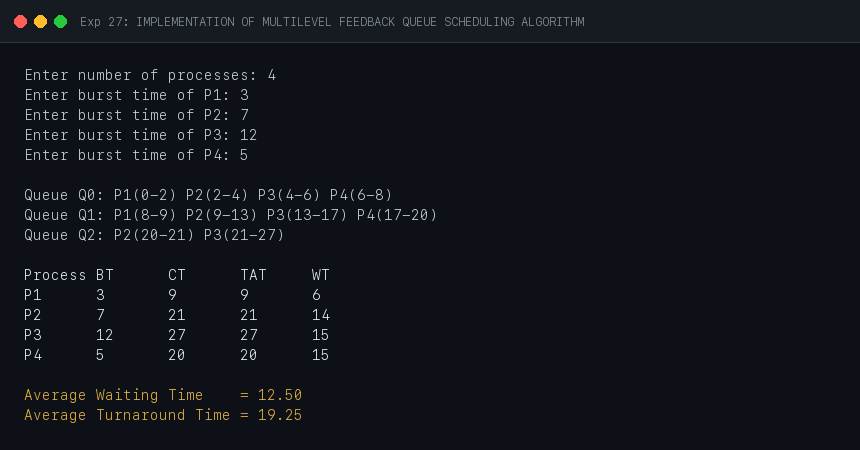

# Experiment 27: IMPLEMENTATION OF MULTILEVEL FEEDBACK QUEUE SCHEDULING ALGORITHM

**Course Outcome:** CO2  
**Course Code:** CSA04 - Operating Systems  
**Student Name:** Rakul K (192525143)  

## AIM
To write a C program to implement Multilevel Feedback Queue scheduling with three queues 
(Q0: RR quantum 2, Q1: RR quantum 4, Q2: FCFS).

## PROCEDURE
1. Read the number of processes and the burst time of each process (all arrive at time 0). 
2. Place all processes in Q0. 
3. Run each process in Q0 for at most 2 units; if it does not finish, move it down to Q1. 
4. Run each process in Q1 for at most 4 units; if it does not finish, move it down to Q2. 
5. Run the processes in Q2 in FCFS order until completion. 
6. Record the completion times and compute waiting and turnaround times.

## SOURCE CODE (main.c)
```c
#include <stdio.h> 
  
int main() 
{ 
    int n, i, level, bt[10], rt[10], ct[10], t = 0; 
    int quantum[3] = {2, 4, 1000}; 
    float twt = 0, ttat = 0; 
  
    printf("Enter number of processes: "); 
    scanf("%d", &n); 
    for (i = 0; i < n; i++) { 
        printf("Enter burst time of P%d: ", i + 1); 
        scanf("%d", &bt[i]); 
        rt[i] = bt[i]; 
    } 
    for (level = 0; level < 3; level++) { 
        printf("\nQueue Q%d: ", level); 
        for (i = 0; i < n; i++) { 
            if (rt[i] == 0) continue; 
            int run = rt[i] < quantum[level] ? rt[i] : quantum[level]; 
            printf("P%d(%d-%d) ", i + 1, t, t + run); 
            t += run; 
            rt[i] -= run; 
            if (rt[i] == 0) ct[i] = t; 
        } 
    } 
    printf("\n\nProcess\tBT\tCT\tTAT\tWT\n"); 
    for (i = 0; i < n; i++) { 
        printf("P%d\t%d\t%d\t%d\t%d\n", i + 1, bt[i], ct[i], ct[i], ct[i] - bt[i]); 
        twt += ct[i] - bt[i]; 
        ttat += ct[i]; 
    } 
    printf("\nAverage Waiting Time    = %.2f\n", twt / n); 
    printf("Average Turnaround Time = %.2f\n", ttat / n); 
    return 0; 
}
```

## INPUT DATA
```
4 
3 
7 
12 
5
```

## EXPECTED & VERIFIED OUTPUT
```
Enter number of processes: 4 
Enter burst time of P1: 3 
Enter burst time of P2: 7 
Enter burst time of P3: 12 
Enter burst time of P4: 5 
  
Queue Q0: P1(0-2) P2(2-4) P3(4-6) P4(6-8) 
Queue Q1: P1(8-9) P2(9-13) P3(13-17) P4(17-20) 
Queue Q2: P2(20-21) P3(21-27) 
  
Process BT      CT      TAT     WT 
P1      3       9       9       6 
P2      7       21      21      14 
P3      12      27      27      15 
P4      5       20      20      15 
  
Average Waiting Time    = 12.50 
Average Turnaround Time = 19.25
```

## TERMINAL OUTPUT SCREENSHOT



## RESULT
Thus the C program to implement Multilevel Feedback Queue scheduling was executed 
successfully.
