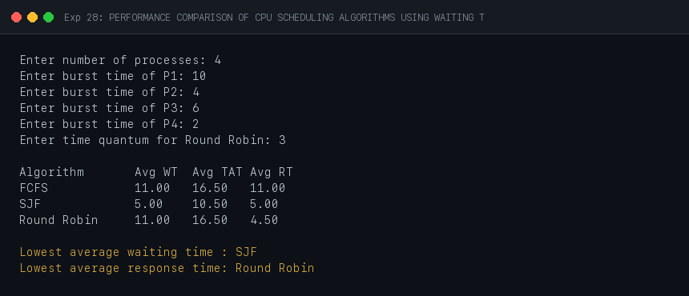

# Experiment 28: PERFORMANCE COMPARISON OF CPU SCHEDULING ALGORITHMS USING WAITING TIME, TURNAROUND TIME, AND RESPONSE TIME

**Course Outcome:** CO2  
**Course Code:** CSA04 - Operating Systems  
**Student Name:** Rakul K (192525143)  

## AIM
To write a C program that compares FCFS, SJF and Round Robin scheduling using average 
waiting time, turnaround time and response time.

## PROCEDURE
1. Read the number of processes, their burst times (arrival time 0) and the time quantum. 
2. FCFS: run the processes in the given order and compute WT, TAT and RT. 
3. SJF: sort the processes by burst time and compute WT, TAT and RT. 
4. Round Robin: simulate the time quantum and compute WT, TAT and RT (RT is the time 
of the first run). 
5. Display the averages of the three algorithms in a table. 
6. Identify the algorithm with the lowest average waiting time.

## SOURCE CODE (main.c)
```c
#include <stdio.h> 
  
int n, bt[10]; 
  
void fcfs(int order[], float *wt, float *tat, float *rt) 
{ 
    int i, t = 0; 
    *wt = *tat = *rt = 0; 
    for (i = 0; i < n; i++) { 
        int p = order[i]; 
        *wt += t; 
        *rt += t; 
        t += bt[p]; 
        *tat += t; 
    } 
    *wt /= n; *tat /= n; *rt /= n; 
} 
  
void rr(int q, float *wt, float *tat, float *rt) 
{ 
    int rem[10], first[10], i, t = 0, left = n; 
    *wt = *tat = *rt = 0; 
    for (i = 0; i < n; i++) { rem[i] = bt[i]; first[i] = -1; } 
    while (left > 0) 
        for (i = 0; i < n; i++) { 
            if (rem[i] == 0) continue; 
            if (first[i] == -1) first[i] = t; 
            int run = rem[i] > q ? q : rem[i]; 
            t += run; 
            rem[i] -= run; 
            if (rem[i] == 0) { 
                left--; 
                *tat += t; 
                *wt += t - bt[i]; 
                *rt += first[i]; 
            } 
        } 
    *wt /= n; *tat /= n; *rt /= n; 
} 
  
int main() 
{ 
    int i, j, q, order[10], t; 
    float w[3], ta[3], r[3]; 
    char *name[3] = {"FCFS", "SJF", "Round Robin"}; 
  
    printf("Enter number of processes: "); 
    scanf("%d", &n); 
    for (i = 0; i < n; i++) { 
        printf("Enter burst time of P%d: ", i + 1); 
        scanf("%d", &bt[i]); 
        order[i] = i; 
    } 
    printf("Enter time quantum for Round Robin: "); 
    scanf("%d", &q); 
  
    fcfs(order, &w[0], &ta[0], &r[0]); 
    for (i = 0; i < n - 1; i++) 
        for (j = 0; j < n - i - 1; j++) 
            if (bt[order[j]] > bt[order[j + 1]]) { 
                t = order[j]; order[j] = order[j + 1]; order[j + 1] = t; 
            } 
    fcfs(order, &w[1], &ta[1], &r[1]); 
    rr(q, &w[2], &ta[2], &r[2]); 
  
    printf("\nAlgorithm\tAvg WT\tAvg TAT\tAvg RT\n"); 
    for (i = 0; i < 3; i++) 
        printf("%-12s\t%.2f\t%.2f\t%.2f\n", name[i], w[i], ta[i], r[i]); 
    j = 0; 
    for (i = 1; i < 3; i++) 
        if (w[i] < w[j]) j = i; 
    printf("\nLowest average waiting time : %s\n", name[j]); 
    j = 0; 
    for (i = 1; i < 3; i++) 
        if (r[i] < r[j]) j = i; 
    printf("Lowest average response time: %s\n", name[j]); 
    return 0; 
}
```

## INPUT DATA
```
4 
10 
4 
6 
2 
3
```

## EXPECTED & VERIFIED OUTPUT
```
Enter number of processes: 4 
Enter burst time of P1: 10 
Enter burst time of P2: 4 
Enter burst time of P3: 6 
Enter burst time of P4: 2 
Enter time quantum for Round Robin: 3 
  
Algorithm       Avg WT  Avg TAT Avg RT 
FCFS            11.00   16.50   11.00 
SJF             5.00    10.50   5.00 
Round Robin     11.00   16.50   4.50 
  
Lowest average waiting time : SJF 
Lowest average response time: Round Robin
```

## TERMINAL OUTPUT SCREENSHOT



## RESULT
Thus the C program to compare the performance of FCFS, SJF and Round Robin scheduling 
was executed successfully.
