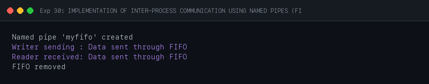

# Experiment 30: IMPLEMENTATION OF INTER-PROCESS COMMUNICATION USING NAMED PIPES (FIFOS)

**Course Outcome:** CO2  
**Course Code:** CSA04 - Operating Systems  
**Student Name:** Rakul K (192525143)  

## AIM
To write a C program to implement inter -process communication between two unrelated 
processes using a named pipe (FIFO).

## PROCEDURE
1. Create a named pipe in the file system using mkfifo(). 
2. Create a child process using fork() to act as the reader. 
3. The writer (parent) opens the FIFO in write mode and writes messages into it. 
4. The reader (child) opens the FIFO in read mode, reads the messages and displays them. 
5. Close the FIFO in both processes and remove it using unlink().

## SOURCE CODE (main.c)
```c
#include <stdio.h> 
#include <string.h> 
#include <fcntl.h> 
#include <unistd.h> 
#include <sys/stat.h> 
#include <sys/wait.h> 
  
int main() 
{ 
    char *fifo = "myfifo"; 
    char buf[100]; 
  
    mkfifo(fifo, 0666); 
    printf("Named pipe '%s' created\n", fifo); 
    fflush(stdout); 
  
    if (fork() == 0) {               /* reader */ 
        int fd = open(fifo, O_RDONLY); 
        int n = read(fd, buf, sizeof(buf) - 1); 
        buf[n] = '\0'; 
        printf("Reader received: %s\n", buf); 
        close(fd); 
        return 0; 
    } 
    int fd = open(fifo, O_WRONLY);     /* writer */ 
    char msg[] = "Data sent through FIFO"; 
    printf("Writer sending : %s\n", msg); 
    fflush(stdout); 
    write(fd, msg, strlen(msg)); 
    close(fd); 
    wait(NULL); 
    unlink(fifo); 
    printf("FIFO removed\n"); 
    return 0; 
}
```

## EXPECTED & VERIFIED OUTPUT
```
Named pipe 'myfifo' created 
Writer sending : Data sent through FIFO 
Reader received: Data sent through FIFO 
FIFO removed
```

## TERMINAL OUTPUT SCREENSHOT



## RESULT
Thus inter-process communication using a named pipe (FIFO) was implemented successfully.
