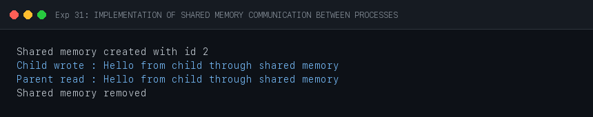

# Experiment 31: IMPLEMENTATION OF SHARED MEMORY COMMUNICATION BETWEEN PROCESSES

**Course Outcome:** CO2  
**Course Code:** CSA04 - Operating Systems  
**Student Name:** Rakul K (192525143)  

## AIM
To write a C program to implement communication between processes using shared memory.

## PROCEDURE
1. Create a shared memory segment using shmget() with IPC_PRIVATE. 
2. Create a child process using fork(). 
3. The child attaches the segment using shmat(), writes a message into it and detaches. 
4. The parent waits for the child, attaches the segment and reads the message. 
5. The parent detaches the segment using shmdt() and removes it using shmctl() with 
IPC_RMID.

## SOURCE CODE (main.c)
```c
#include <stdio.h> 
#include <string.h> 
#include <unistd.h> 
#include <sys/ipc.h> 
#include <sys/shm.h> 
#include <sys/wait.h> 
  
int main() 
{ 
    int shmid = shmget(IPC_PRIVATE, 1024, IPC_CREAT | 0666); 
    if (shmid < 0) { perror("shmget"); return 1; } 
    printf("Shared memory created with id %d\n", shmid); 
    fflush(stdout); 
  
    if (fork() == 0) { 
        char *mem = (char *)shmat(shmid, NULL, 0); 
        strcpy(mem, "Hello from child through shared memory"); 
        printf("Child wrote : %s\n", mem); 
        shmdt(mem); 
        return 0; 
    } 
    wait(NULL); 
    char *mem = (char *)shmat(shmid, NULL, 0); 
    printf("Parent read : %s\n", mem); 
    shmdt(mem); 
    shmctl(shmid, IPC_RMID, NULL); 
    printf("Shared memory removed\n"); 
    return 0; 
}
```

## EXPECTED & VERIFIED OUTPUT
```
Shared memory created with id 2 
Child wrote : Hello from child through shared memory 
Parent read : Hello from child through shared memory 
Shared memory removed
```

## TERMINAL OUTPUT SCREENSHOT



## RESULT
Thus communication between processes using shared memory was implemented successfully.
