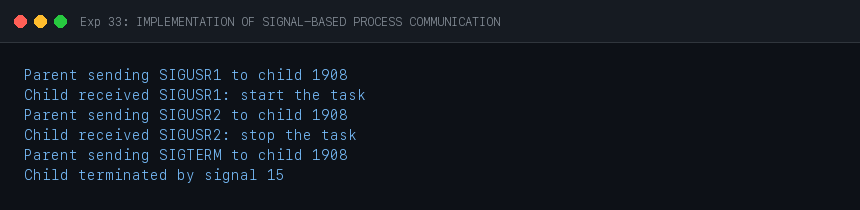

# Experiment 33: IMPLEMENTATION OF SIGNAL-BASED PROCESS COMMUNICATION

**Course Outcome:** CO2  
**Course Code:** CSA04 - Operating Systems  
**Student Name:** Rakul K (192525143)  

## AIM
To write a C program to implement communication between processes using signals.

## PROCEDURE
1. Write a signal handler function for SIGUSR1 and SIGUSR2. 
2. Register the handler using signal(). 
3. Create a child process using fork(); the child waits for signals using pause(). 
4. The parent sends SIGUSR1 and SIGUSR2 to the child using kill(). 
5. The child displays a message for each signal received. 
6. Finally the parent sends SIGTERM to terminate the child and waits for it.

## SOURCE CODE (main.c)
```c
#include <stdio.h> 
#include <signal.h> 
#include <unistd.h> 
#include <sys/wait.h> 
  
void handler(int sig) 
{ 
    if (sig == SIGUSR1) 
        printf("Child received SIGUSR1: start the task\n"); 
    else if (sig == SIGUSR2) 
        printf("Child received SIGUSR2: stop the task\n"); 
    fflush(stdout); 
} 
  
int main() 
{ 
    int status; 
    signal(SIGUSR1, handler); 
    signal(SIGUSR2, handler); 
  
    pid_t pid = fork(); 
    if (pid == 0) { 
        while (1) 
            pause(); 
    } 
    sleep(1); 
    printf("Parent sending SIGUSR1 to child %d\n", pid); 
    fflush(stdout); 
    kill(pid, SIGUSR1); 
    sleep(1); 
    printf("Parent sending SIGUSR2 to child %d\n", pid); 
    fflush(stdout); 
    kill(pid, SIGUSR2); 
    sleep(1); 
    printf("Parent sending SIGTERM to child %d\n", pid); 
    kill(pid, SIGTERM); 
    wait(&status); 
    if (WIFSIGNALED(status)) 
        printf("Child terminated by signal %d\n", WTERMSIG(status)); 
    return 0; 
}
```

## EXPECTED & VERIFIED OUTPUT
```
Parent sending SIGUSR1 to child 1908 
Child received SIGUSR1: start the task 
Parent sending SIGUSR2 to child 1908 
Child received SIGUSR2: stop the task 
Parent sending SIGTERM to child 1908 
Child terminated by signal 15
```

## TERMINAL OUTPUT SCREENSHOT



## RESULT
Thus communication between processes using signals was implemented successfully.
