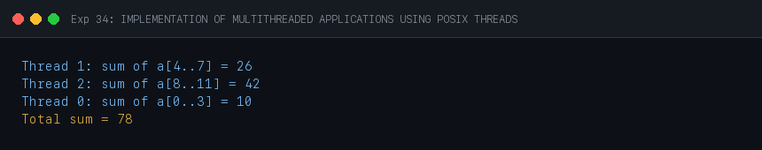

# Experiment 34: IMPLEMENTATION OF MULTITHREADED APPLICATIONS USING POSIX THREADS

**Course Outcome:** CO2  
**Course Code:** CSA04 - Operating Systems  
**Student Name:** Rakul K (192525143)  

## AIM
To write a multithreaded C program using POSIX threads that finds the sum of an array by 
dividing the work among threads.

## PROCEDURE
1. Declare a global array of 12 numbers and an array to hold the partial sums. 
2. Write a thread function that adds the elements of its own part of the array. 
3. Create 3 threads using pthread_create(), passing each thread its index. 
4. Wait for all threads using pthread_join(). 
5. Add the partial sums to get the total and display it.

## SOURCE CODE (main.c)
```c
#include <stdio.h> 
#include <pthread.h> 
  
#define N 12 
#define T 3 
int a[N] = {1, 2, 3, 4, 5, 6, 7, 8, 9, 10, 11, 12}; 
int partial[T]; 
  
void *sum_part(void *arg) 
{ 
    int id = *(int *)arg, i; 
    int start = id * (N / T), end = start + N / T; 
    partial[id] = 0; 
    for (i = start; i < end; i++) 
        partial[id] += a[i]; 
    printf("Thread %d: sum of a[%d..%d] = %d\n", id, start, end - 1, partial[id]); 
    return NULL; 
} 
  
int main() 
{ 
    pthread_t th[T]; 
    int id[T], i, total = 0; 
  
    for (i = 0; i < T; i++) { 
        id[i] = i; 
        pthread_create(&th[i], NULL, sum_part, &id[i]); 
    } 
    for (i = 0; i < T; i++) 
        pthread_join(th[i], NULL); 
    for (i = 0; i < T; i++) 
        total += partial[i]; 
    printf("Total sum = %d\n", total); 
    return 0; 
}
```

## EXPECTED & VERIFIED OUTPUT
```
Thread 1: sum of a[4..7] = 26 
Thread 2: sum of a[8..11] = 42 
Thread 0: sum of a[0..3] = 10 
Total sum = 78
```

## TERMINAL OUTPUT SCREENSHOT



## RESULT
Thus the multithreaded application using POSIX threads was implemented successfully.
