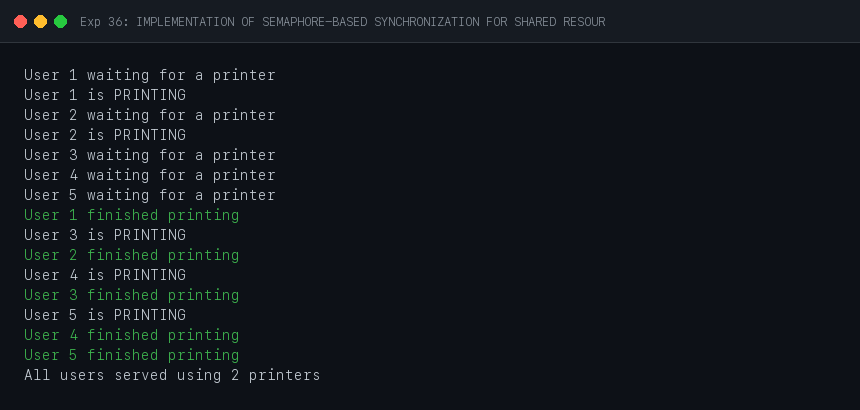

# Experiment 36: IMPLEMENTATION OF SEMAPHORE-BASED SYNCHRONIZATION FOR SHARED RESOURCES

**Course Outcome:** CO2  
**Course Code:** CSA04 - Operating Systems  
**Student Name:** Rakul K (192525143)  

## AIM
To write a C program that uses a counting semaphore to control access to a shared resource 
that has a limited number of instances.

## PROCEDURE
1. Assume there are 2 printers (resource instances) and 5 users (threads). 
2. Initialise a counting semaphore to 2 using sem_init(). 
3. Each thread calls sem_wait() before using a printer; if both printers are busy it waits. 
4. The thread uses the printer for a short time and then calls sem_post() to release it. 
5. Create 5 threads and wait for them to finish; destroy the semaphore.

## SOURCE CODE (main.c)
```c
#include <stdio.h> 
#include <pthread.h> 
#include <semaphore.h> 
#include <unistd.h> 
  
sem_t printers; 
  
void *user(void *arg) 
{ 
    int id = *(int *)arg; 
    printf("User %d waiting for a printer\n", id); 
    sem_wait(&printers); 
    printf("User %d is PRINTING\n", id); 
    usleep(300000); 
    printf("User %d finished printing\n", id); 
    sem_post(&printers); 
    return NULL; 
} 
  
int main() 
{ 
    pthread_t t[5]; 
    int id[5], i; 
    sem_init(&printers, 0, 2); 
    for (i = 0; i < 5; i++) { 
        id[i] = i + 1; 
        pthread_create(&t[i], NULL, user, &id[i]); 
        usleep(50000); 
    } 
    for (i = 0; i < 5; i++) 
        pthread_join(t[i], NULL); 
    sem_destroy(&printers); 
    printf("All users served using 2 printers\n"); 
    return 0; 
}
```

## EXPECTED & VERIFIED OUTPUT
```
User 1 waiting for a printer 
User 1 is PRINTING 
User 2 waiting for a printer 
User 2 is PRINTING 
User 3 waiting for a printer 
User 4 waiting for a printer 
User 5 waiting for a printer 
User 1 finished printing 
User 3 is PRINTING 
User 2 finished printing 
User 4 is PRINTING 
User 3 finished printing 
User 5 is PRINTING 
User 4 finished printing 
User 5 finished printing 
All users served using 2 printers
```

## TERMINAL OUTPUT SCREENSHOT



## RESULT
Thus semaphore-based synchronisation for a shared resource was implemented successfully; 
at most two users printed at the same time.
