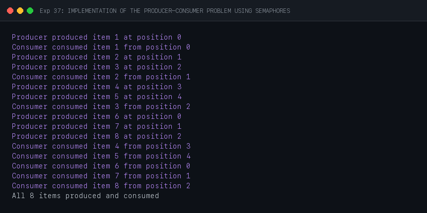

# Experiment 37: IMPLEMENTATION OF THE PRODUCER–CONSUMER PROBLEM USING SEMAPHORES

**Course Outcome:** CO2  
**Course Code:** CSA04 - Operating Systems  
**Student Name:** Rakul K (192525143)  

## AIM
To write a C program to solve the producer-consumer problem using semaphores.

## PROCEDURE
1. Declare a buffer of size 5 with in and out indices. 
2. Initialise semaphore empty = 5, semaphore full = 0 and a mutex for the buffer. 
3. Producer: wait(empty), lock mutex, put an item into the buffer, unlock mutex, 
signal(full). 
4. Consumer: wait(full), lock mutex, remove an item from the buffer, unlock mutex, 
signal(empty). 
5. Create one producer thread and one consumer thread that produce and consume 8 items. 
6. Join the threads and display the result.

## SOURCE CODE (main.c)
```c
#include <stdio.h> 
#include <pthread.h> 
#include <semaphore.h> 
#include <unistd.h> 
  
#define SIZE 5 
#define ITEMS 8 
int buffer[SIZE], in = 0, out = 0; 
sem_t empty, full; 
pthread_mutex_t mutex = PTHREAD_MUTEX_INITIALIZER; 
  
void *producer(void *arg) 
{ 
    for (int item = 1; item <= ITEMS; item++) { 
        sem_wait(&empty); 
        pthread_mutex_lock(&mutex); 
        buffer[in] = item; 
        printf("Producer produced item %d at position %d\n", item, in); 
        in = (in + 1) % SIZE; 
        pthread_mutex_unlock(&mutex); 
        sem_post(&full); 
        usleep(100000); 
    } 
    return NULL; 
} 
  
void *consumer(void *arg) 
{ 
    for (int i = 1; i <= ITEMS; i++) { 
        sem_wait(&full); 
        pthread_mutex_lock(&mutex); 
        int item = buffer[out]; 
        printf("Consumer consumed item %d from position %d\n", item, out); 
        out = (out + 1) % SIZE; 
        pthread_mutex_unlock(&mutex); 
        sem_post(&empty); 
        usleep(250000); 
    } 
    return NULL; 
} 
  
int main() 
{ 
    pthread_t p, c; 
    sem_init(&empty, 0, SIZE); 
    sem_init(&full, 0, 0); 
    pthread_create(&p, NULL, producer, NULL); 
    pthread_create(&c, NULL, consumer, NULL); 
    pthread_join(p, NULL); 
    pthread_join(c, NULL); 
    printf("All %d items produced and consumed\n", ITEMS); 
    return 0; 
}
```

## EXPECTED & VERIFIED OUTPUT
```
Producer produced item 1 at position 0 
Consumer consumed item 1 from position 0 
Producer produced item 2 at position 1 
Producer produced item 3 at position 2 
Consumer consumed item 2 from position 1 
Producer produced item 4 at position 3 
Producer produced item 5 at position 4 
Consumer consumed item 3 from position 2 
Producer produced item 6 at position 0 
Producer produced item 7 at position 1 
Producer produced item 8 at position 2 
Consumer consumed item 4 from position 3 
Consumer consumed item 5 from position 4 
Consumer consumed item 6 from position 0 
Consumer consumed item 7 from position 1 
Consumer consumed item 8 from position 2 
All 8 items produced and consumed
```

## TERMINAL OUTPUT SCREENSHOT



## RESULT
Thus the producer-consumer problem was solved using semaphores successfully.
