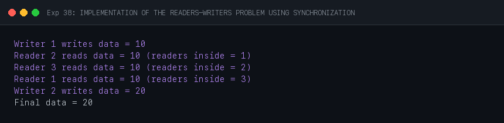

# Experiment 38: IMPLEMENTATION OF THE READERS–WRITERS PROBLEM USING SYNCHRONIZATION PRIMITIVES

**Course Outcome:** CO2  
**Course Code:** CSA04 - Operating Systems  
**Student Name:** Rakul K (192525143)  

## AIM
To write a C program to solve the readers -writers problem using semaphores and a mutex, so 
that many readers can read together but a writer gets exclusive access.

## PROCEDURE
1. Declare a shared variable data, a counter read_count, a mutex for read_count and a 
semaphore wrt initialised to 1. 
2. Reader: lock mutex, increment read_count; if it is the first reader, wait(wrt); unlock 
mutex. 
3. Reader: read the data, then lock mutex, decrement read_count; if it is the last reader, 
signal(wrt); unlock mutex. 
4. Writer: wait(wrt), modify the data, signal(wrt). 
5. Create 3 reader threads and 2 writer threads and join them.

## SOURCE CODE (main.c)
```c
#include <stdio.h> 
#include <pthread.h> 
#include <semaphore.h> 
#include <unistd.h> 
  
int data = 0, read_count = 0; 
sem_t wrt; 
pthread_mutex_t mutex = PTHREAD_MUTEX_INITIALIZER; 
  
void *reader(void *arg) 
{ 
    int id = *(int *)arg; 
    pthread_mutex_lock(&mutex); 
    read_count++; 
    if (read_count == 1) sem_wait(&wrt); 
    pthread_mutex_unlock(&mutex); 
  
    printf("Reader %d reads data = %d (readers inside = %d)\n", id, data, read_count); 
    usleep(200000); 
  
    pthread_mutex_lock(&mutex); 
    read_count--; 
    if (read_count == 0) sem_post(&wrt); 
    pthread_mutex_unlock(&mutex); 
    return NULL; 
} 
  
void *writer(void *arg) 
{ 
    int id = *(int *)arg; 
    sem_wait(&wrt); 
    data += 10; 
    printf("Writer %d writes data = %d\n", id, data); 
    usleep(200000); 
    sem_post(&wrt); 
    return NULL; 
} 
  
int main() 
{ 
    pthread_t r[3], w[2]; 
    int rid[3] = {1, 2, 3}, wid[2] = {1, 2}, i; 
    sem_init(&wrt, 0, 1); 
  
    pthread_create(&w[0], NULL, writer, &wid[0]); 
    usleep(50000); 
    for (i = 0; i < 3; i++) 
        pthread_create(&r[i], NULL, reader, &rid[i]); 
    usleep(50000); 
    pthread_create(&w[1], NULL, writer, &wid[1]); 
  
    for (i = 0; i < 3; i++) pthread_join(r[i], NULL); 
    for (i = 0; i < 2; i++) pthread_join(w[i], NULL); 
    printf("Final data = %d\n", data); 
    return 0; 
}
```

## EXPECTED & VERIFIED OUTPUT
```
Writer 1 writes data = 10 
Reader 2 reads data = 10 (readers inside = 1) 
Reader 3 reads data = 10 (readers inside = 2) 
Reader 1 reads data = 10 (readers inside = 3) 
Writer 2 writes data = 20 
Final data = 20
```

## TERMINAL OUTPUT SCREENSHOT



## RESULT
Thus the readers-writers problem was solved using synchronisation primitives successfully.
