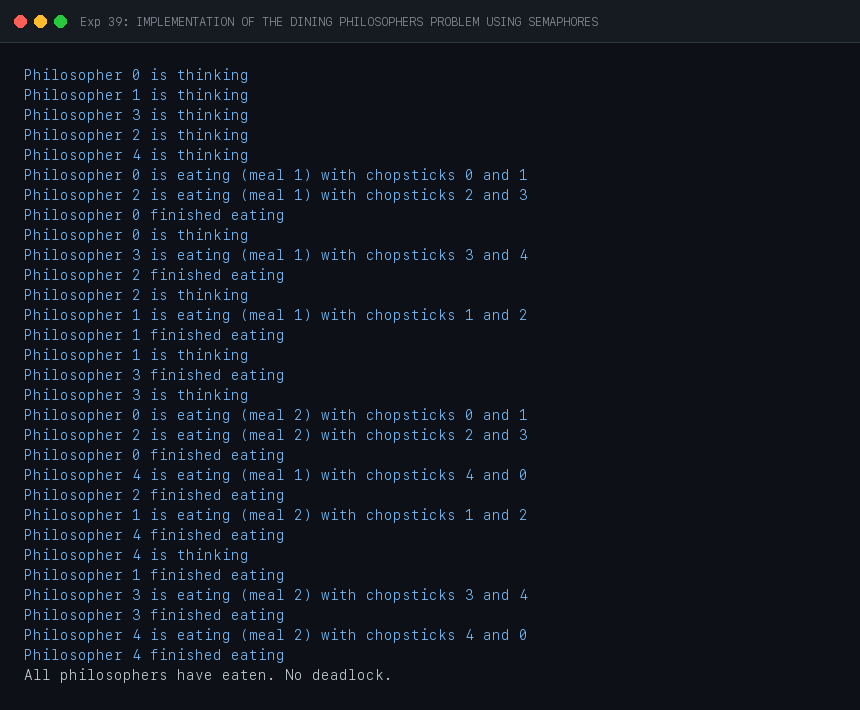

# Experiment 39: IMPLEMENTATION OF THE DINING PHILOSOPHERS PROBLEM USING SEMAPHORES

**Course Outcome:** CO2  
**Course Code:** CSA04 - Operating Systems  
**Student Name:** Rakul K (192525143)  

## AIM
To write a C program to solve the dining philosophers problem using semaphores without 
deadlock.

## PROCEDURE
1. Represent each of the 5 chopsticks by a binary semaphore initialised to 1. 
2. Each philosopher thinks, picks up two chopsticks, eats and puts them down. 
3. To avoid deadlock, the even -numbered philosophers pick up the left chopstick first and 
the odd-numbered philosophers pick up the right chopstick first. 
4. Each philosopher eats twice. 
5. Create 5 philosopher threads and join them.

## SOURCE CODE (main.c)
```c
#include <stdio.h> 
#include <pthread.h> 
#include <semaphore.h> 
#include <unistd.h> 
  
#define N 5 
sem_t chopstick[N]; 
  
void *philosopher(void *arg) 
{ 
    int id = *(int *)arg; 
    int left = id, right = (id + 1) % N; 
    int first = (id % 2 == 0) ? left : right; 
    int second = (id % 2 == 0) ? right : left; 
  
    for (int meal = 1; meal <= 2; meal++) { 
        printf("Philosopher %d is thinking\n", id); 
        usleep(100000); 
        sem_wait(&chopstick[first]); 
        sem_wait(&chopstick[second]); 
        printf("Philosopher %d is eating (meal %d) with chopsticks %d and %d\n", id, 
meal, left, right); 
        usleep(150000); 
        sem_post(&chopstick[second]); 
        sem_post(&chopstick[first]); 
        printf("Philosopher %d finished eating\n", id); 
    } 
    return NULL; 
} 
  
int main() 
{ 
    pthread_t t[N]; 
    int id[N], i; 
    for (i = 0; i < N; i++) 
        sem_init(&chopstick[i], 0, 1); 
    for (i = 0; i < N; i++) { 
        id[i] = i; 
        pthread_create(&t[i], NULL, philosopher, &id[i]); 
    } 
    for (i = 0; i < N; i++) 
        pthread_join(t[i], NULL); 
    printf("All philosophers have eaten. No deadlock.\n"); 
    return 0; 
}
```

## EXPECTED & VERIFIED OUTPUT
```
Philosopher 0 is thinking 
Philosopher 1 is thinking 
Philosopher 3 is thinking 
Philosopher 2 is thinking 
Philosopher 4 is thinking 
Philosopher 0 is eating (meal 1) with chopsticks 0 and 1 
Philosopher 2 is eating (meal 1) with chopsticks 2 and 3 
Philosopher 0 finished eating 
Philosopher 0 is thinking 
Philosopher 3 is eating (meal 1) with chopsticks 3 and 4 
Philosopher 2 finished eating 
Philosopher 2 is thinking 
Philosopher 1 is eating (meal 1) with chopsticks 1 and 2 
Philosopher 1 finished eating 
Philosopher 1 is thinking 
Philosopher 3 finished eating 
Philosopher 3 is thinking 
Philosopher 0 is eating (meal 2) with chopsticks 0 and 1 
Philosopher 2 is eating (meal 2) with chopsticks 2 and 3 
Philosopher 0 finished eating 
Philosopher 4 is eating (meal 1) with chopsticks 4 and 0 
Philosopher 2 finished eating 
Philosopher 1 is eating (meal 2) with chopsticks 1 and 2 
Philosopher 4 finished eating 
Philosopher 4 is thinking 
Philosopher 1 finished eating 
Philosopher 3 is eating (meal 2) with chopsticks 3 and 4 
Philosopher 3 finished eating 
Philosopher 4 is eating (meal 2) with chopsticks 4 and 0 
Philosopher 4 finished eating 
All philosophers have eaten. No deadlock.
```

## TERMINAL OUTPUT SCREENSHOT



## RESULT
Thus the dining philosophers problem was solved using semaphores without deadlock.
