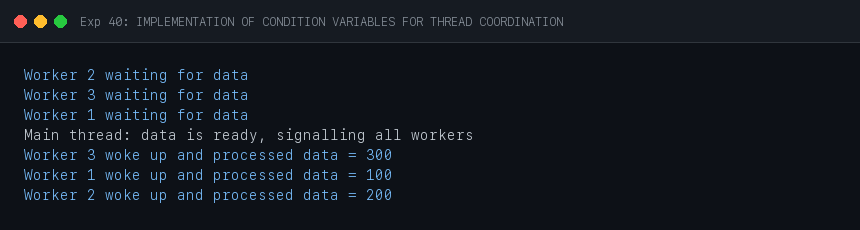

# Experiment 40: IMPLEMENTATION OF CONDITION VARIABLES FOR THREAD COORDINATION

**Course Outcome:** CO2  
**Course Code:** CSA04 - Operating Systems  
**Student Name:** Rakul K (192525143)  

## AIM
To write a C program that coordinates threads using condition variables.

## PROCEDURE
1. Declare a mutex, a condition variable and a shared flag ready = 0. 
2. Create three worker threads. Each worker locks the mutex and waits on the condition 
variable while ready is 0. 
3. The main thread prepares the data, sets ready = 1 and wakes all workers using 
pthread_cond_broadcast(). 
4. Each worker, after waking up, processes the data and unlocks the mutex. 
5. Join all threads.

## SOURCE CODE (main.c)
```c
#include <stdio.h> 
#include <pthread.h> 
#include <unistd.h> 
  
pthread_mutex_t m = PTHREAD_MUTEX_INITIALIZER; 
pthread_cond_t cond = PTHREAD_COND_INITIALIZER; 
int ready = 0, data = 0; 
  
void *worker(void *arg) 
{ 
    int id = *(int *)arg; 
    pthread_mutex_lock(&m); 
    while (ready == 0) { 
        printf("Worker %d waiting for data\n", id); 
        pthread_cond_wait(&cond, &m); 
    } 
    printf("Worker %d woke up and processed data = %d\n", id, data * id); 
    pthread_mutex_unlock(&m); 
    return NULL; 
} 
  
int main() 
{ 
    pthread_t t[3]; 
    int id[3] = {1, 2, 3}, i; 
    for (i = 0; i < 3; i++) 
        pthread_create(&t[i], NULL, worker, &id[i]); 
    sleep(1); 
  
    pthread_mutex_lock(&m); 
    data = 100; 
    ready = 1; 
    printf("Main thread: data is ready, signalling all workers\n"); 
    pthread_cond_broadcast(&cond); 
    pthread_mutex_unlock(&m); 
  
    for (i = 0; i < 3; i++) 
        pthread_join(t[i], NULL); 
    return 0; 
}
```

## EXPECTED & VERIFIED OUTPUT
```
Worker 2 waiting for data 
Worker 3 waiting for data 
Worker 1 waiting for data 
Main thread: data is ready, signalling all workers 
Worker 3 woke up and processed data = 300 
Worker 1 woke up and processed data = 100 
Worker 2 woke up and processed data = 200
```

## TERMINAL OUTPUT SCREENSHOT



## RESULT
Thus thread coordination using condition variables was implemented successfully.
